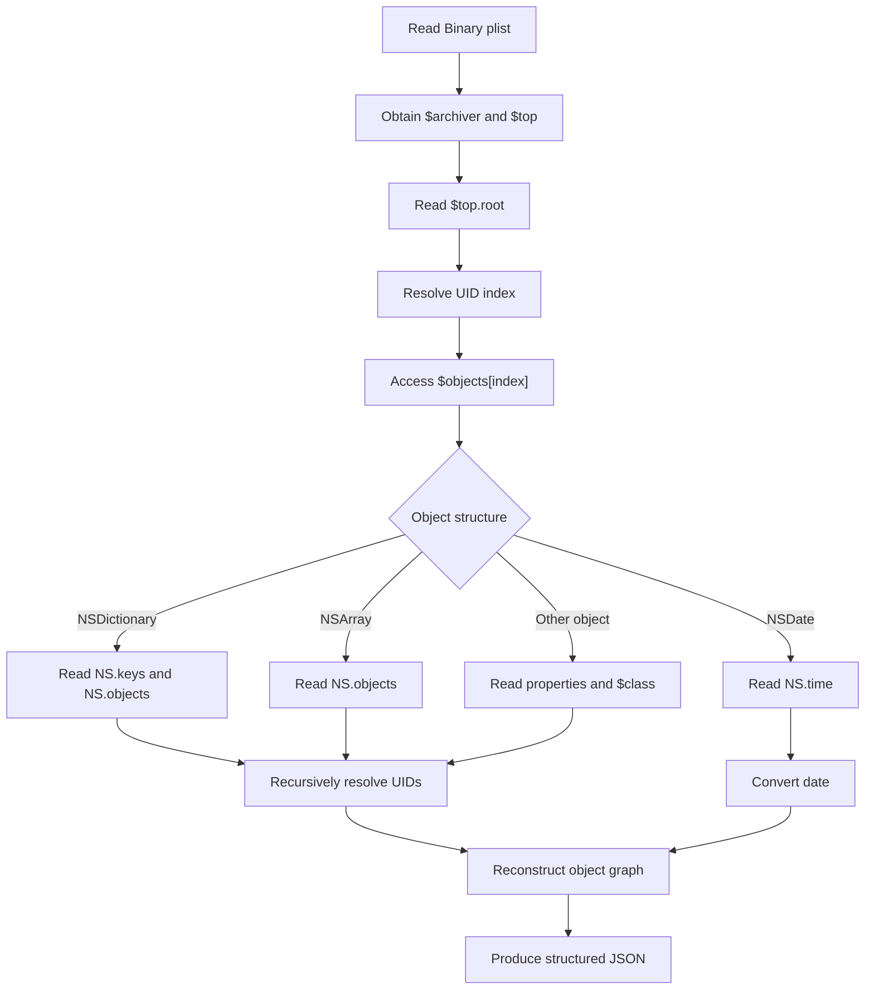
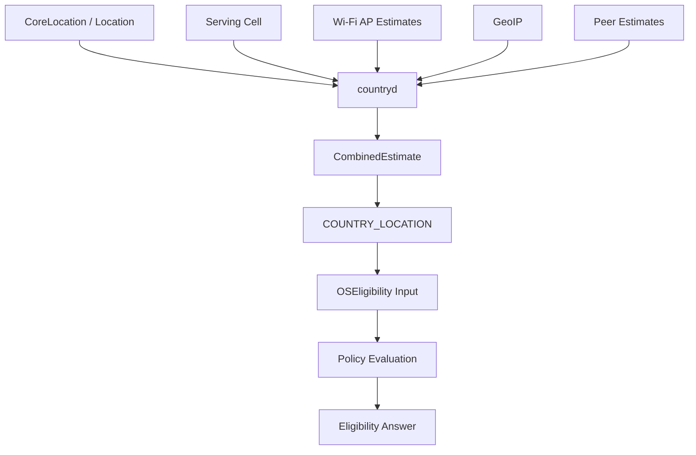
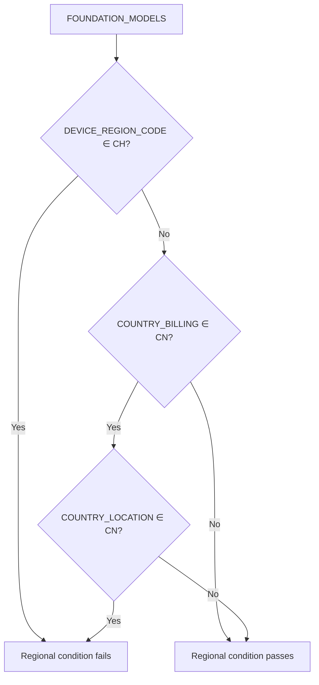
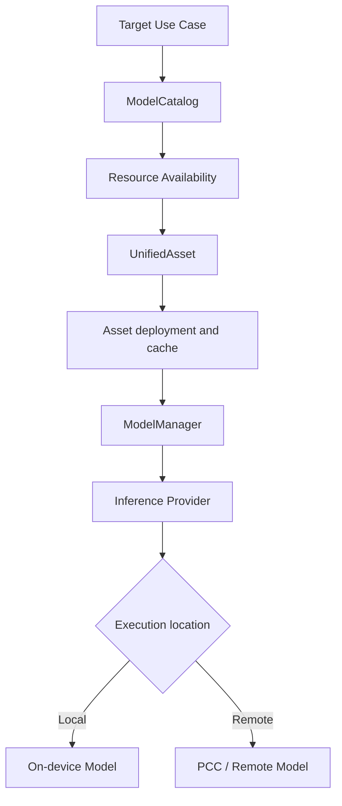
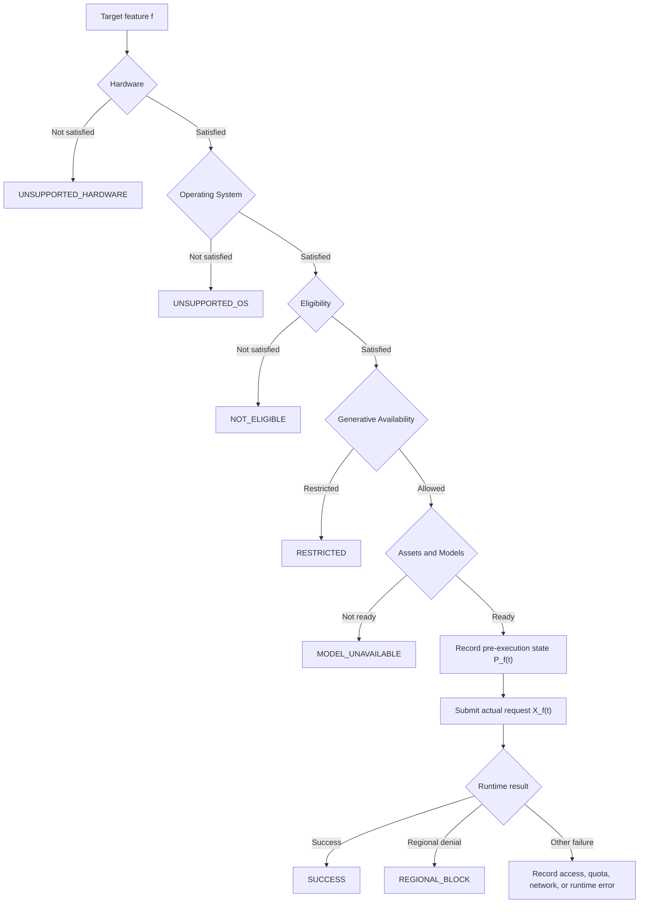
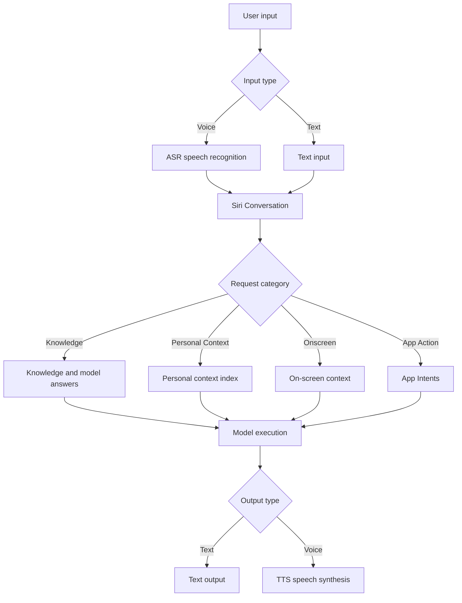
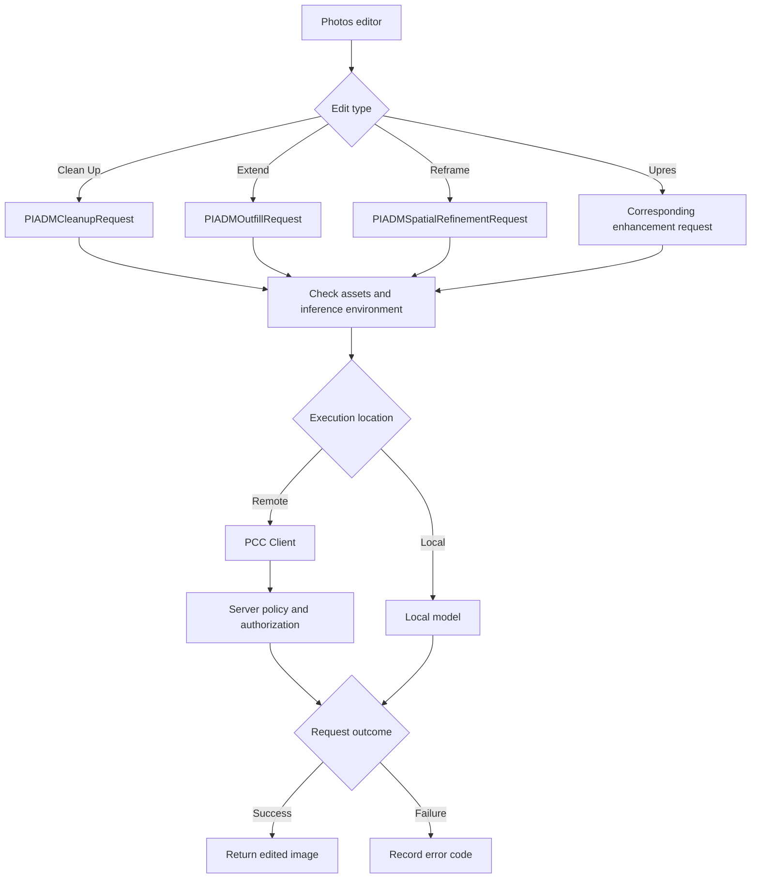
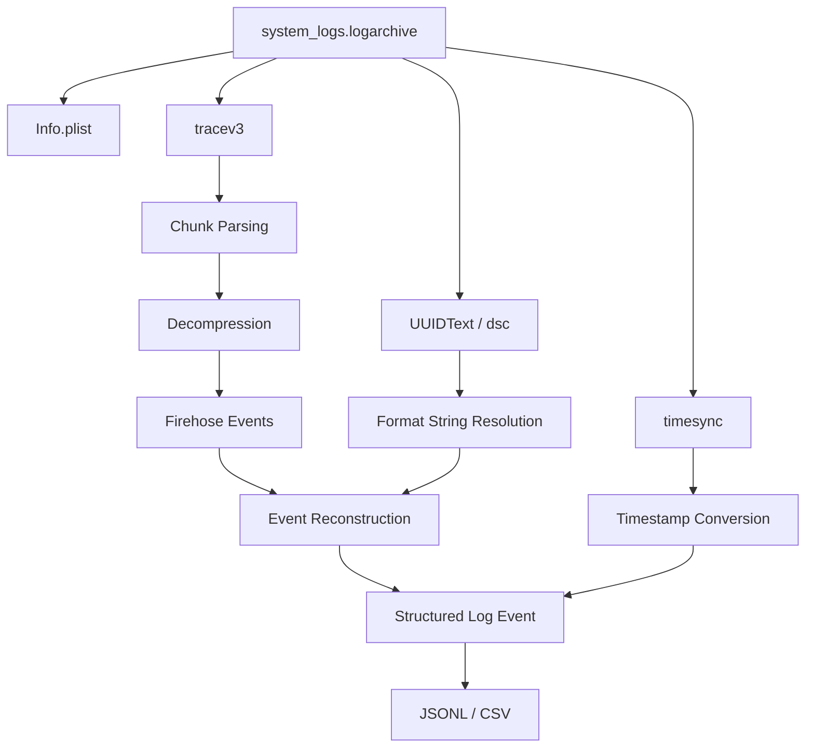
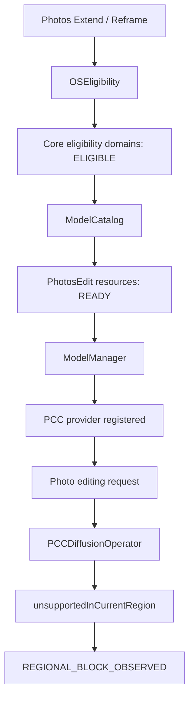
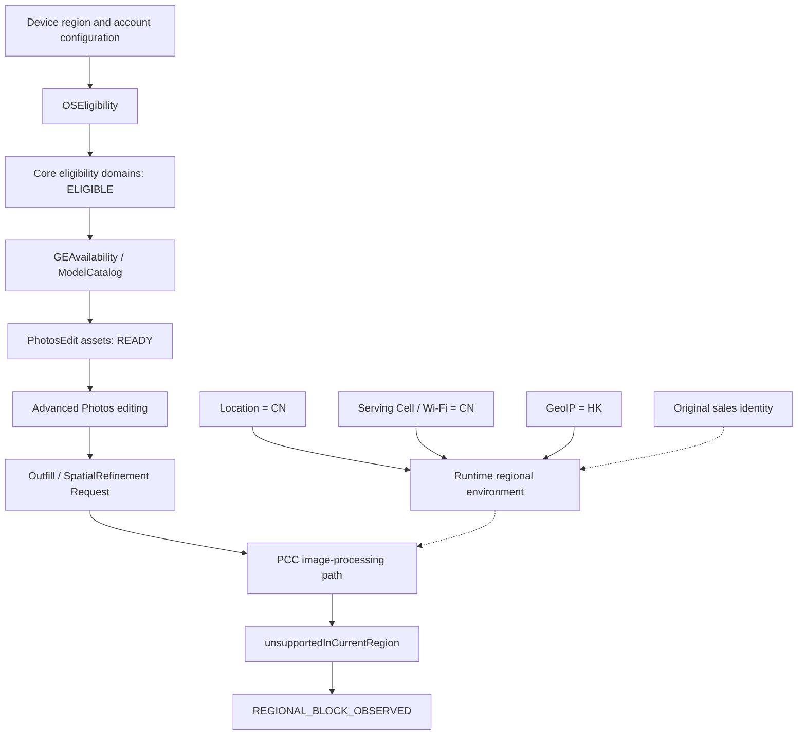

# An Empirical Study of Apple Intelligence Regional Eligibility, Feature Availability, and System Runtime Mechanisms Using iOS sysdiagnose

## Research Environment and Scope

This study uses an **iPhone 15 Pro Max purchased by the researcher in mainland China**[^1] as the primary test device. The research combines hands-on device testing, comparisons of system configurations, analysis of raw sysdiagnose data, and inspection of Unified Logs events.

**Test device and software environment:**

| Item | Research configuration |
|---|---|
| Test device | iPhone 15 Pro Max |
| Product identifier | `iPhone16,2` |
| Hardware model | `A3108` (iPhone 15 Pro Max model covering mainland China, Hong Kong, and Macao; this particular device was purchased in mainland China) |
| Operating system | iOS 27.3 Developer Beta 1 |
| OS build | `24C5037i` |
| Configuration research tools | GestaltX and MobileGestalt data export tools |
| Device-region investigation | `RegionCode`, `SalesRegion`, and related cached attributes |
| Account environment | US-region Apple Account, App Store, Media & Purchases |
| Language environment | English, Traditional Chinese, and combinations of Siri language settings |
| Network environment | Wi-Fi, cellular networks, proxies, and different network egress locations |
| Diagnostic sources | sysdiagnose, GestaltX plist exports, model catalogs, runtime logs, and exception reports |
| Local analysis environment | Windows; offline analysis of plist, JSON, text, and Unified Logs |
| Study period | November 2026 |
| Public-source verification date | November 16, 2026 |

The results below describe observations made on the researcher's device in this environment. Results on other devices, including devices of the same model, depend on their configurations, operating system versions, account environments, and runtime conditions. Experiments involving beta software, changes to device parameters, firmware restoration, or system-cache manipulation may involve data loss, device-identification issues, warranty disputes, or system malfunction. This study distinguishes publicly documented rules, facts found in raw diagnostics, and analytical models derived from the evidence.

---

## Abstract

**Objective:** To investigate the mechanisms governing Apple Intelligence feature activation, regional eligibility, model-resource management, and inference execution in iOS; analyze system eligibility and feature runtime behavior on a device sold in mainland China; and establish a reproducible method for extracting and analyzing sysdiagnose data.

**Methods:** The study uses controlled tests on a physical device, Property List parsing, reconstruction of NSKeyedArchiver object graphs, logical analysis of eligibility policies, Unified Logging decoding, and cross-file evidence correlation. These methods are applied to device configuration, country estimates, system eligibility, generative-feature availability, model resources, and runtime errors.

**Results:** The researcher's organized core diagnostic archive contains 1,136 files, 1,021 of which belong to the system-log archive. System eligibility data includes 222 eligibility domains and 28 inputs; GEAvailability records 63 asset-ready use cases; and ModelCatalog contains 347 resource-availability sections. Some Apple Intelligence operations completed successfully, whereas photo extension and spatial reframing produced `PCCDiffusionOperatorError.unsupportedInCurrentRegion` during execution. The collected records expose distinct data paths for country determination, device region, account region, and model readiness.

**Conclusion:** Apple Intelligence feature availability can be studied at six levels: hardware, operating system, eligibility, feature-level availability, model assets, and runtime execution. Explaining an individual feature's behavior requires correlating the relevant policy evaluation, resource snapshots, and actual request events within a traceable evidence chain.

**Keywords:** Apple Intelligence; iOS 27; sysdiagnose; OSEligibility; MobileGestalt; countryd; GEAvailability; ModelCatalog; Private Cloud Compute; Unified Logging; regional eligibility

---

## 1. Introduction

### 1.1 Background

Apple Intelligence is a collection of generative AI capabilities integrated into Apple's operating systems. It encompasses Siri AI, text generation, image generation, photo editing, intelligent search, notification understanding, and in-app intelligent actions.

Its operation involves on-device processing, system eligibility decisions, asset deployment, and, for some workloads, cloud inference. Apple uses Private Cloud Compute (PCC) for certain computationally intensive requests[^2] and applies service conditions and usage quotas to features that depend on server-side models.[^3][^4][^5]

For devices sold in mainland China, the relationship between hardware capability, system-reported eligibility, separate regional signals, and actual feature outcomes forms the central subject of this research.

The study cross-checks real execution records against raw system data to address three questions: **What determines system-level feature eligibility? Which components deliver each feature? At what stage does an unsuccessful request fail?**

### 1.2 Research Objectives

The study develops four interconnected lines of investigation:

| Area | Central question | Output |
|---|---|---|
| sysdiagnose data extraction | Where are the data stored, in which formats, and how can readable values be reconstructed? | Directory, field, and encoding indexes |
| System eligibility | How do device properties, account, region, and language affect policy evaluation? | Eligibility Policy logic model |
| Apple Intelligence execution | How do features connect to models, services, PCC, and quotas? | Six-level availability model |
| Empirical evidence | How can enabled features and execution failures be explained? | Cross-source evidence correlation and failure classification |

### 1.3 Research Design and Evidence Levels

The empirical materials comprise a baseline sysdiagnose collected in November 2026, a Photos PCC-focused snapshot assembled on November 13, two MobileGestalt cache exports, and associated hands-on operation records. Unless stated otherwise, diagnostic paths are relative to the **root of the extracted sysdiagnose directory, `./`**. Separately exported device configurations and restore logs are identified in the relevant sections.

Device-identification and restore logs were used to confirm `ProductType = iPhone16,2`, `iOS 27.3`, and build `24C5037i`. Hands-on tests recorded behavior involving Siri AI, image generation, photo editing, and changes in network conditions. The November 13 snapshot was used to cross-check the eligibility and model state associated with photo editing.

Technical descriptions use Apple's documentation and public research into relevant file formats, cited at their points of use. Empirical counts, feature outcomes, and private fields are recorded in the body and appendices with searchable relative paths and original key names.

The following evidence levels are used:

| Evidence level | Definition |
|---|---|
| A — Original execution evidence | Decoded request types, return values, error codes, and timestamps from logs |
| B — Structured system state | Raw snapshots from OSEligibility, GEAvailability, ModelManager, and similar components |
| C — Hands-on device evidence | Observed success or failure and system UI state |
| D — Technical inference | Interpretations obtained by correlating multiple evidence sources |

---

## 2. The sysdiagnose Dataset and File Organization

### 2.1 Sample Statistics

All non-directory files were recursively enumerated from the extracted sysdiagnose root, `./`, and grouped by their top-level directory.

**Table 1. Core sysdiagnose archive statistics**

| Directory | File count | Main contents |
|---|---:|---|
| `system_logs.logarchive/` | 1,021 | Unified Logs, string tables, time synchronization, and statistics |
| `logs/` | 109 | System eligibility, country estimates, model catalogs, and asset configuration |
| `cr/` | 6 | Jetsam and memory-resource exceptions |
| **Total** | **1,136** | Core diagnostic materials |

The archive includes **66 `.tracev3` files** and **one `.timesync` file**. The log archive and system-state snapshots together form the principal evidence base.

### 2.1.1 Counting Methods for Structured Data

The sysdiagnose root (`./`) is the reference for all paths. The file total counts non-directory entries. Eligibility domains, use cases, and model entries are counted from parsed objects and full resource identifiers.

**Table 1-1. Counts of key structured diagnostic objects**

| Data location | Item counted | Count |
|---|---|---:|
| `./logs/OSEligibility/state.plist` | Domains in `OS_ELIGIBILITY_STATE_DUMP_DOMAINS` | 222 |
| Same file | Inputs in `OS_ELIGIBILITY_STATE_DUMP_INPUTS` | 28 |
| `./logs/GenerativeExperiences/GEAvailability.log` | Distinct use-case keys in `Assets ready` | 63 |
| Same file | Use-case keys in `Unified Reasons` | 2 |
| `./logs/ModelCatalog/model_catalog_dump.txt` | `Availability for ...:` sections | 347 |
| Same file | Resource identifiers deduplicated by their full strings | 347 |

ModelCatalog resource identifiers can include feature, style, and configuration suffixes, such as `VisualGeneration.GenerativePlayground:animation:animation`. Full identifiers are retained when counting, so each distinct configuration variant is represented as its own resource entry.

### 2.2 Directory Organization

```text
sysdiagnose/
│
├── logs/
│   ├── OSEligibility/
│   ├── Country/
│   ├── GenerativeExperiences/
│   ├── ModelCatalog/
│   ├── ModelManager/
│   ├── UnifiedAsset/
│   ├── MobileAsset/
│   ├── Trial/
│   └── DeviceConfiguration/
│
├── system_logs.logarchive/
│   ├── Info.plist
│   ├── Persist/
│   ├── Special/
│   ├── Signpost/
│   ├── timesync/
│   ├── dsc/
│   ├── Extra/
│   └── 00/ ... FF/
│
└── cr/
    ├── JetsamEvent-*.ips
    └── me/
        └── *.lite_diag
```

Supplementary network and service diagnostics also contain locations such as `./logs/Networking/`, `./summaries/`, and `./crashes_and_spins/`. These support network, Siri, and exception analysis.

Apple's diagnostic documentation describes the use of sysdiagnose to collect system state, crash data, and recent logs. This study obtains runtime evidence from the archive's `system_logs.logarchive`.[^6][^7]

### 2.3 Principal Diagnostic Files and Encodings

**Table 2. Core source files, purposes, and formats**

| Relative path | Research content | Format |
|---|---|---|
| `logs/OSEligibility/state.plist` | Eligibility inputs, policies, and answers | XML plist |
| `logs/Country/countryCodeCache.plist` | Country estimates and location sources | Binary plist / NSKeyedArchiver |
| `logs/GenerativeExperiences/GEAvailability.log` | AI feature states and restriction reasons | JSON |
| `logs/ModelCatalog/model_catalog_dump.txt` | Model assets and supported configurations | Structured text |
| `logs/ModelManager/model_manager_dump.json` | Inference providers, assets, requests, and sessions | JSON |
| `logs/UnifiedAsset/unified_asset_manager.log` | Asset deployment, subscriptions, caching, and errors | JSON |
| `logs/MobileAsset/history/*` | Asset download and deployment history | Text logs |
| `logs/Trial/*` | Feature rollouts and experiment policy | Indented text |
| `logs/DeviceConfiguration/**/*` | Effective system and user configurations | plist |
| `system_logs.logarchive/Info.plist` | Unified Logs archive metadata | XML plist |
| `system_logs.logarchive/Persist/*.tracev3` | Historical system events | tracev3 |
| `system_logs.logarchive/timesync/*` | Log time synchronization | Binary |
| `cr/JetsamEvent-*.ips` | Memory pressure and process termination | Diagnostic JSON |
| `cr/me/*.lite_diag` | Memory-resource exceptions and stacks | Binary plist |

The sections below explain their internal structures, decoding techniques, and relationships.

---

## 3. Raw Data Encoding and Deserialization

### 3.1 Property Lists as a System Configuration Format

A Property List (**plist**) is a common structured-data format on Apple platforms. Its value types include Dictionary, Array, String, Integer, Real, Boolean, Date, and Data (binary data).[^8][^9]

The two principal plist encodings are XML and Binary. Both can represent the same logical object hierarchy but use different physical storage formats.[^8][^10]

**Table 3. Recognizing plist encodings**[^8][^11]

| Encoding | File signature | Parsing method |
|---|---|---|
| XML plist | `<?xml` and `<plist>` | XML DOM and recursive object conversion |
| Binary plist | `bplist00` | Object table, offset table, and reference indices |
| Keyed Archive | `$archiver` present inside a plist | UID references and object-graph reconstruction |

Basic Binary plist layout:

```text
┌─────────────────────────────┐
│ Header: bplist00            │
├─────────────────────────────┤
│ Object Table                │
│ Object contents, types, refs│
├─────────────────────────────┤
│ Offset Table                │
│ Byte positions of objects   │
├─────────────────────────────┤
│ Trailer: 32 Bytes           │
│ Object count, ref widths,   │
│ and top object              │
└─────────────────────────────┘
```

**Table 4. Binary plist Trailer fields**[^9]

| Relative trailer offset | Length | Contents |
|---|---|---|
| `0x06` | 1 byte | `offsetIntSize` |
| `0x07` | 1 byte | `objectRefSize` |
| `0x08–0x0F` | 8 bytes | `numObjects` |
| `0x10–0x17` | 8 bytes | `topObject` |
| `0x18–0x1F` | 8 bytes | `offsetTableOffset` |

Multi-byte integers use big-endian byte order. A decoder reads the Trailer, locates objects through the Offset Table, then recursively reconstructs values using type information in the Object Table.

### 3.2 NSKeyedArchiver: Reconstructing Object References

NSKeyedArchiver is a keyed object-archiving mechanism in Apple's Foundation framework. It stores object graphs with reference relationships, including relationships more complex than nested dictionaries.[^11][^12][^10]

The sampled `countryCodeCache.plist` uses this mechanism.

Main archive keys:

```text
$archiver
$version
$top
$objects
```

Example:

```text
$top.root = UID(1)

$objects[1] = {
    LocalCountryEstimatesLocation: UID(2),
    LocalCountryEstimatesServingCell: UID(9),
    LocalCountryEstimatesWiFiAPs: UID(12),
    LocalCountryEstimatesGeoIP: UID(15),
    CombinedEstimate: UID(19)
}
```

Here `UID(2)` is a reference to `$objects[2]`, not the country-estimate object itself. The decoder resolves that reference and uses `NS.objects`, `NS.keys`, and `$class` as appropriate to reconstruct the original structure.

**Figure 1. NSKeyedArchiver object reconstruction**[^12]



The primary implementation concerns are **object identity, reference relationships, array ordering, and class metadata**. Apple's archiving documentation describes the underlying mechanisms.[^10]

### 3.3 Other Data Formats

**Table 5. Parsing other diagnostic formats**[^8][^13][^14]

| Type | Identifying feature | Processing method |
|---|---|---|
| JSON | A complete `{}` or `[]` structure | Deserialize JSON |
| JSONL | One independent JSON object per line | Stream and parse line by line |
| `.ips` | JSON metadata and a separate report body | Parse the parts separately |
| `.lite_diag` | `bplist00` in some samples | Decode Binary plist |
| Trial text | Indented policy/factor records | Reconstruct hierarchy from indentation |
| ModelCatalog text | `Availability for ...` | Split into resource sections |
| MobileAsset history | Timestamps and `key=value` records | Parse key-value entries line by line |
| `.tracev3` | Apple Unified Logging binary structure | Jointly decode log chunks, string tables, and time synchronization |

---
## 4. Device Identity, Region, and Location Determination

### 4.1 Multiple Regional Inputs

iOS receives region information from several sources. To analyze eligibility and server-side authorization, the configured device region, sales region, account region, current country estimate, and network egress country are recorded separately.

**Table 6. Regional inputs observed on the test device**

| Variable | Observed value | Original source |
|---|---|---|
| `DEVICE_REGION_CODE` | `ZA` | OSEligibility |
| `RegionCode` | `ZA` | MobileGestalt |
| `SalesRegion` | `ZA/A` | MobileGestalt |
| `COUNTRY_BILLING` | `US` | Apple Account eligibility input |
| `COUNTRY_LOCATION` | `CN` | countryd / OSEligibility |
| `DEVICE_LOCALE` | `TW` | System localization configuration |
| `SIRI_LANGUAGE` | `zh-TW` | Siri language input |
| `CHINA_CELLULAR` | `N` | OSEligibility |
| `PRECISE_LOCATION` | Empty set, confidence 2 | OSEligibility |

During the experiment, GestaltX was used to export MobileGestalt state before and after changes to device configuration. The two `CacheData` values were then compared byte by byte. OSEligibility values in this table were taken from `./logs/OSEligibility/state.plist`; country estimates were taken from `./logs/Country/countryCodeCache.plist`.

### 4.2 MobileGestalt Region Cache

MobileGestalt is a mechanism used by Apple systems to expose device capabilities, hardware characteristics, and certain configuration attributes.

The researcher exported its cache using GestaltX. The main root objects were:

```text
CacheUUID
CacheVersion
CacheData
CacheExtra
GestaltXDeviceProof
```

`CacheExtra` uses hashed property keys.

**Table 7. Field mappings identified in the study sample**

| CacheExtra key | Property | Research purpose |
|---|---|---|
| `h63QSdBCiT/z0WU6rdQv6Q` | `RegionCode` | Configured device region |
| `yK+xavymRGZ3xWc1tb8XDg` | `SalesRegion` | Configured sales region |
| `xNN67KktpWp7syTT3S1BFA` | `ProductType` | Hardware model |

`CacheData` contains a binary cache. Comparison of the two exports revealed changes at two byte positions.

**Table 8. Changes in CacheData**

| Relative offset | Earlier export | Later export |
|---|---|---|
| `0xBF8` | `0x01` | `0x00` |
| `0xFD0` | `0x00` | `0x01` |

These offsets were investigated as possible locations of region-related cached markers such as `green-tea` and `not-green-tea`. The byte-level differences are directly established by the exports. Confirming a mapping between the named markers and these offsets requires validation against the `iPhone16,2` cache layout.

### 4.3 countryd: Country-Location Estimation

countryd is the system's country-estimation mechanism. It collects country information from location services, cellular networks, Wi-Fi, IP-related sources, and other available inputs.[^15][^16]

**Original file:**

```text
.\logs\Country\countryCodeCache.plist
```

The NSKeyedArchiver root object in the sample is `RDCachedData`, which stores multiple `RDEstimate` objects.

**Table 9. Country estimates recorded by countryd**

| Source | Field | Country | Priority |
|---|---|---|---|
| Location services | `LocalCountryEstimatesLocation` | `CN` | 4 |
| Serving cell | `LocalCountryEstimatesServingCell` | `CN` | 2 |
| Wi-Fi access points | `LocalCountryEstimatesWiFiAPs` | `CN` | 1 |
| Public IP | `LocalCountryEstimatesGeoIP` | `HK` | 5 |
| Nearby cells | `LocalCountryEstimatesNearbyCells` | No record | — |
| Peer estimates | `PeerEstimates` | Empty object | — |
| Combined country estimate | `CombinedEstimate` | `CN` | — |
| Previous combined result | `LastKnownCombinedEstimate` | `CN` | — |

Each `RDEstimate` record contains `CountryCode`, `Priority`, `Timestamp`, and `Disputed`.[^17]

`Priority` is the priority attribute stored in the archive. `CombinedEstimate` is the combined result retained by the system. Investigating the underlying fusion algorithm requires examining countryd's implementation and runtime records.

### 4.4 Relationship Between Country Estimates and Eligibility Inputs

**Figure 2. countryd country estimates and eligibility inputs**



Account country and configured device region enter eligibility evaluation through their respective input channels.

The regional information can be represented as:

$$
\mathcal{R} =
\{
R_{\mathrm{device}},
R_{\mathrm{sales}},
R_{\mathrm{billing}},
R_{\mathrm{location}},
R_{\mathrm{IP}}
\}
$$

Each variable represents a distinct regional signal.

### 4.5 DeviceConfiguration: Effective System and User Settings

Effective settings are stored under `./logs/DeviceConfiguration/{System,User}/EffectiveConfigurations/`, grouped by configuration namespace. An individual namespace's `EffectiveConfiguration/` directory primarily contains:

| File | Available information |
|---|---|
| `EffectiveValues.plist` | Currently effective configuration values and settings |
| `EffectivePriorities.plist` | Priority assigned to the corresponding values |
| `EffectiveBlame.plist` | Source or attribution information for each effective value |

By recursively enumerating `com.apple.<Namespace>` directories, corresponding keys from these three plists can be associated by field path. Namespaces observed in the sample include `com.apple.modelcatalog` and `com.apple.AudioIntelligence`.

---

## 5. OSEligibility System Eligibility Evaluation

### 5.1 Data Structure

OSEligibility is a principal source for investigating Apple Intelligence regional restrictions.

**Original file:**

```text
.\logs\OSEligibility\state.plist
```

The sampled `state.plist` is an XML plist. Parsing `OS_ELIGIBILITY_STATE_DUMP_DOMAINS` yields **222 eligibility domains**; parsing `OS_ELIGIBILITY_STATE_DUMP_INPUTS` yields **28 inputs**. Their latest recorded outcomes can be obtained from `OS_ELIGIBILITY_STATE_DUMP_LAST_ANSWERS`. The root object contains seven principal entries.

| Root key | Contents |
|---|---|
| `OS_ELIGIBILITY_STATE_DUMP_DOMAINS` | Domain names and raw Policy expressions |
| `OS_ELIGIBILITY_STATE_DUMP_GLOBAL_STATE` | Global eligibility state |
| `OS_ELIGIBILITY_STATE_DUMP_INPUTS` | Descriptions of eligibility input objects |
| `OS_ELIGIBILITY_STATE_DUMP_INPUT_OVERRIDES` | Input overrides |
| `OS_ELIGIBILITY_STATE_DUMP_LAST_ANSWERS` | Most recent answers and condition states |
| `OS_ELIGIBILITY_STATE_DUMP_MOBILE_ASSET` | Eligibility-related assets |
| `OS_ELIGIBILITY_STATE_DUMP_OVERRIDES` | Domain-level overrides |

**A notable encoding detail:** Many entries under `INPUTS` are textual descriptions of Objective-C objects, such as `LocatedCountryInput` and `CountryBillingInput`. Domain policies are likewise stored as nested expressions in text form. `LAST_ANSWERS` provides comparatively structured dictionaries.

### 5.2 All 28 Eligibility Inputs

**Table 10. OSEligibility input fields by category**

| Category | Raw fields |
|---|---|
| Countries and regions | `COUNTRY_BILLING`, `COUNTRY_LOCATION`, `PRECISE_LOCATION`, `INITIAL_SETUP_LOCATION`, `SHIPTO_LOCATION`, `DEVICE_REGION_CODE`, `DEVICE_LOCALE` |
| Device capability | `DEVICE_CLASS`, `DEVICE_TYPE`, `CELLULAR_CAPABLE_DEVICE`, `CHINA_CELLULAR`, `GENERATIVE_MODEL_SYSTEM`, `HAS_LINWOOD` |
| Siri and language | `DEVICE_LANGUAGE`, `SIRI_LANGUAGE`, `DEVICE_AND_SIRI_LANGUAGE_MATCH`, `DEVICE_SIRI_MODE` |
| System environment | `EXTERNAL_BOOT_DRIVE`, `SHARED_IPAD`, `GREYMATTER_ON_QUEUE`, `PHONE_APP_REMOVAL` |
| Age and account | `AGE_ASSURANCE_AREA_ID`, `BIRTHDATE`, `IS_CHILD`, `IS_TEEN`, `IS_AGE_VERIFIED_ADULT`, `IS_ACCOUNT_ELIGIBILE_FOR_AGE_ASSURANCE`, `IS_CONNECTED_TO_AGE_VERIFIED_ADULT` |

In `INPUTS`, the field names are prefixed with `OS_ELIGIBILITY_INPUT_`.

Examples:

```text
OS_ELIGIBILITY_INPUT_COUNTRY_LOCATION
OS_ELIGIBILITY_INPUT_DEVICE_REGION_CODE
OS_ELIGIBILITY_INPUT_SIRI_LANGUAGE
```

### 5.3 Policy Expressions

OSEligibility evaluates eligibility through nested policies.

**Table 11. Policy syntax**

| Policy element | Meaning |
|---|---|
| `InputPolicy` | Evaluate a specified input condition |
| `AndPolicy` | All child conditions must be satisfied |
| `OrPolicy` | At least one child condition must be satisfied |
| `NotPolicy` | Negate a child condition |
| `inArray` | Determine whether a scalar input belongs to a specified set |
| `anyInArray` | Determine whether at least one array element belongs to a specified set |
| `AISupportedLanguagesPolicy` | Evaluate device and Siri language eligibility |
| `GracePeriodPolicy` | Apply a grace-period state or temporal rule |
| `notSetAnswer` | Specified answer to use when an input is unset |
| `isControlFlow` | A marker for control-flow semantics within a policy node |

A domain's evaluation can be expressed as:

$$
E_D=\operatorname{Eval}(Policy_D,Inputs)
$$

Here, \(D\) identifies an eligibility domain.

### 5.4 FOUNDATION_MODELS Regional Policy

In the study sample, `FOUNDATION_MODELS` (Domain 130) contains the following policy:

```text
NotPolicy(
    OrPolicy(
        DEVICE_REGION_CODE inArray(CH),
        AndPolicy(
            COUNTRY_BILLING inArray(CN),
            COUNTRY_LOCATION anyInArray(CN)
        )
    )
)
```

Define:

$$
R=[DEVICE\_REGION\_CODE\in\{CH\}]
$$

$$
B=[COUNTRY\_BILLING\in\{CN\}]
$$

$$
L=[COUNTRY\_LOCATION\in\{CN\}]
$$

The resulting regional condition is:

$$
E_{\mathrm{FoundationRegion}}
=\neg\left(R\lor(B\land L)\right)
$$

The expression contains two regional branches: a device-region match and a conjunction of billing country and current country location. The raw Policy is located at `OS_ELIGIBILITY_STATE_DUMP_DOMAINS["FOUNDATION_MODELS"]` in `./logs/OSEligibility/state.plist`. The corresponding evaluation is located in `OS_ELIGIBILITY_STATE_DUMP_LAST_ANSWERS["FOUNDATION_MODELS"]`.

**Figure 3. FOUNDATION_MODELS regional eligibility**



### 5.5 Major Apple Intelligence Eligibility Domains

**Table 12. Core domains and observed results**

| Domain | ID | Scope | Answer |
|---|---:|---|---|
| `GREYMATTER` | 122 | Basic Apple Intelligence eligibility | `ELIGIBLE` |
| `AMERICIUM` | 96 | Intelligent services and Siri-related capabilities | `ELIGIBLE` |
| `SIRI_MODE` | 155 | Siri mode eligibility | `ELIGIBLE` |
| `FOUNDATION_MODELS` | 130 | Foundation Models eligibility | `ELIGIBLE` |
| `SIRI_WITH_APP_INTENTS` | — | Siri app-action eligibility | `ELIGIBLE` |
| `DUBNIUM` | 106 | Watch-related eligibility | `NOT_ELIGIBLE` |

The policies associated with `GREYMATTER`, `AMERICIUM`, and `SIRI_MODE` include device class, language, Siri state, regional conditions, and other capability checks.

For example, the `LAST_ANSWERS` snapshot for `SIRI_MODE` contains:

```text
COUNTRY_BILLING       = ELIGIBLE
COUNTRY_LOCATION      = NOT_ELIGIBLE
DEVICE_REGION_CODE    = ELIGIBLE
SIRI_LANGUAGE         = ELIGIBLE

Final Answer          = ELIGIBLE
```

The final answer is computed from the domain's complete Policy tree.

### 5.6 Other Regional and Regulatory Eligibility Domains

**Table 13. Regional and regulatory policies**

| Domain | Main policy logic | Observed answer |
|---|---|---|
| `LANTHANUM` | `COUNTRY_LOCATION ∈ CN` | `ELIGIBLE` |
| `AI_LABELING` | `REGION ∈ CH OR (BILLING ∈ CN AND LOCATION ∈ CN)` | `NOT_ELIGIBLE` |
| `XENON` | Multi-region exclusions and `GracePeriodPolicy` | `NOT_ELIGIBLE` |
| `CALCIUM` | Device class, `REGION=CH`, and `CHINA_CELLULAR` | `NOT_ELIGIBLE` |
| `FLEROVIUM` | Location or billing country belongs to US/GB | `ELIGIBLE` |
| `RUBIDIUM` | Device-region exclusion and billing-country allowlist | `ELIGIBLE` |

The age-assurance system also uses:

```text
ADULT_AGE_VERIFICATION_REQUIRED
AGE_ASSURANCE_JURISDICTION_LIFECYCLE
AGE_ASSURANCE_REGULATORY_FEATURES
MOLYBDENUM
```

These domains concern age-assurance jurisdictions, precise location, date of birth, account-age status, and eligibility for parental or adult management.

---
## 6. Six-Level Apple Intelligence Feature Availability Model

### 6.1 Model Definition

This study divides Apple Intelligence diagnosis into two stages: **pre-execution validation** and **runtime execution**.

For a target feature \(f\) at observation time \(t\), the combined pre-execution condition is defined as:

$$
P_f(t)=H_f(t)\land O_f(t)\land E_f(t)\land G_f(t)\land A_f(t)
$$

| Symbol | Full name | Role in the study |
|---|---|---|
| \(H_f\) | Hardware Capability | Hardware model and feature-specific hardware requirements |
| \(O_f\) | Operating System Compatibility | OS version, language, and configuration |
| \(E_f\) | Feature Eligibility | OSEligibility policy results for relevant domains |
| \(G_f\) | Generative Availability | Feature-level state reported by GEAvailability |
| \(A_f\) | Asset and Model Readiness | Model, dependent assets, and inference-provider state |
| \(P_f\) | Pre-execution Conditions | Combined value of the pre-execution conditions |

Runtime execution is defined as:

$$
X_f(t)=\operatorname{Execute}(f,\operatorname{Context}_t)
$$

Here, \(\operatorname{Context}_t\) includes the network, region, account, service conditions, request parameters, and runtime environment at the moment the request is made. The resulting state \(R_f(t)\) is classified according to the original events:

$$
R_f(t)\in\{
\mathrm{SUCCESS},\,
\mathrm{REGIONAL\_BLOCK},\,
\mathrm{ACCESS\_DENIED},\,
\mathrm{QUOTA\_EXCEEDED},\,
\mathrm{MODEL\_ERROR},\,
\mathrm{NETWORK\_ERROR},\,
\mathrm{RUNTIME\_ERROR},\,
\mathrm{UNKNOWN}
\}
$$

For each level, its original state, timestamp, source path, and feature identifier are retained for cross-file correlation.

### 6.2 Hardware: Device Capability

In iOS 27, compatible Apple Intelligence devices include iPhone 15 Pro, iPhone 15 Pro Max, the iPhone 16 family, and subsequent compatible models. Some advanced capabilities have additional device requirements.[^3][^4][^1][^3]

The main hardware fields examined in this study are:

| Field | Research purpose |
|---|---|
| `ProductType` | Identify the actual hardware model |
| `DEVICE_CLASS` | Determine device platform/class |
| `DEVICE_TYPE` | Check requirements for specific device types |
| `GENERATIVE_MODEL_SYSTEM` | Check support for the generative-model system |
| `HAS_LINWOOD` | Examine Linwood capability state |
| `DEVICE_SIRI_MODE` | Examine Siri mode configuration |

### 6.3 Operating System: Software Environment

Operating-system conditions are divided into the following components:[^3][^4]

$$
O_F=
OS_F\land Language_F\land Configuration_F
$$

| Condition | Relevant information |
|---|---|
| OS support | iOS version, build, and feature-specific minimum version |
| Language support | `DEVICE_LANGUAGE`, `SIRI_LANGUAGE` |
| Language matching | `DEVICE_AND_SIRI_LANGUAGE_MATCH` |
| Feature configuration | Siri mode, system settings, and required frameworks |
| Resource storage | Available storage needed for feature-specific models |

Apple's iOS 27 documentation specifies supported conditions for device language and Siri language. Siri AI Beta also has its own language, account-region, and feature requirements.[^3][^4]

### 6.4 Eligibility: System Policy Conditions

`E_F` is obtained primarily from the Domain policies and `LAST_ANSWERS` in `state.plist`.

The complete evaluation path is:

```text
Target feature
    ↓
Identify associated eligibility domains
    ↓
Read policies
    ↓
Load inputs
    ↓
Evaluate And / Or / Not / GracePeriod
    ↓
Compute Eligibility Answer
```

For a feature associated with multiple domains:

$$
E_F=\operatorname{PolicyCombine}(E_{D_1},E_{D_2},\ldots,E_{D_n})
$$

`PolicyCombine` is determined by the policies associated with the target feature.

### 6.5 Generative Availability: Feature-Level Access

**Original file:**

```text
.\logs\GenerativeExperiences\GEAvailability.log
```

The file is complete JSON.

Core object path:

```text
availability
  .cached
  .useCaseBlockList
```

Its child groups include:

```text
Assets ready
Unified Reasons
Policy limited
Access not granted
Updated since boot
```

The sample contains 63 entries in `Assets ready`. Two Partner use cases also include recorded reasons.

| Use Case | Raw reason |
|---|---|
| `com.apple.Settings.AppleIntelligence.Partner.ChatGPT` | `useCaseDoesNotAllowCurrentIPCountryCode` |
| `com.apple.Settings.AppleIntelligence.Partner.Snowflake` | `partnerNotSelected` |

The first records an IP-country restriction at the feature level. The second indicates that the corresponding partner was not selected.

These two records illustrate separate feature-policy outcomes: **regional restriction** and **partner configuration state**.

### 6.5.1 Changes in ChatGPT Extension State Across Tests

The GEAvailability snapshot collected on November 12, 2026 contains the following restriction reason:

```text
availability.cached.useCaseBlockList
  ["Unified Reasons"]
  ["com.apple.Settings.AppleIntelligence.Partner.ChatGPT"]
  [0].restricted._0
  .useCaseDoesNotAllowCurrentIPCountryCode
```

This field corresponds to a current-IP-country restriction for the ChatGPT Partner use case. During a later hands-on test, the researcher successfully connected and linked the ChatGPT extension.

| Test stage | Evidence source | Observation |
|---|---|---|
| Initial snapshot (2026-11-12) | `./logs/GenerativeExperiences/GEAvailability.log` | `useCaseDoesNotAllowCurrentIPCountryCode` |
| Later functional test | ChatGPT extension UI on the device | Connection and linking succeeded |

Useful data for correlating the two observations include the network egress country, Partner use-case status, request timestamps, and relevant service logs.

### 6.6 Assets and Models: Resource Availability

Three major components are involved in assessing model readiness. The device's `./logs/ModelCatalog/model_catalog_dump.txt` contains **347** availability sections beginning with `Availability for`. Deduplication using each complete identifier still yields **347 resource identifiers**. Each section records its own `ready for` conditions and related resource information.

**ModelCatalog** records whether a use case or model group has the required resources available. In entries such as `PhotosEdit.Outfill.1p`, `ready for: ["(all,all)"]` indicates that the catalog reports readiness for the listed configurations.

**ModelManager** records model assets, inference providers, model requests, and sessions.

**UnifiedAsset** records asset downloading, deployment, caching, and subscriptions.

Their relationship is illustrated below.

**Figure 4. Model resources and inference providers**



Inference providers can be identified in ModelManager through `inferenceProviders[].descriptor.id`.

The study sample includes:

```text
pcc-agent-client
```

It also contains:

```text
hostedOnServer = true
```

Assets associated with remote model groups include `noise_predictor`, `vae_encoder`, `vae_decoder`, and `textencoder`.

### 6.7 Execution: Runtime Requests and Results

A request may be executed by an on-device model or a remote inference service.[^5][^18]

PCC's architecture involves verified compute nodes, request encryption, software attestation, and cloud model execution.[^2] Apple's Private Cloud Compute security research provides technical details on this architecture.[^5]

Execution can be expressed as:

$$
X_f(t)=\operatorname{Execute}(f,\operatorname{Context}_t)
$$

`Context_t` represents the device, network, and service environment when a request is issued.

**Figure 5. Apple Intelligence pre-execution and runtime decision path**



---

## 7. Apple Intelligence Features, Resources, and Execution Paths

### 7.1 Feature Groups

The study organizes Apple Intelligence according to user-visible functionality and internal use cases.

**Table 14. Major feature groups**[^3][^4]

| Feature group | User-visible capability | Main internal use cases or assets |
|---|---|---|
| Siri AI | Intelligent conversations, personal context, on-screen awareness | `Siri.Conversation` and Siri-related services |
| Writing Tools | Rewriting, proofreading, summarization, smart replies | `textComposition.*` |
| Image Playground | Prompt-based and personalized image generation | `ImagePlayground.Creation.*` |
| Genmoji | Generate emoji from descriptions | `VisualGeneration.KeyboardEmojiGenerator` |
| Image Wand | Image generation from drawings and context | `handwriting.synthesis` |
| Photos editing | Clean Up, Extend, spatial reframing, enhancement | `PhotosEdit.*` |
| Mail and Messages | Summaries, classification, smart replies | `summarization.*`, `classification.*` |
| Notifications | Summaries and priority detection | Notification use cases |
| Visual Intelligence | Understanding visual content | `VisualIntelligence.*` |
| Shortcuts | AI-generated actions and model invocations | App Intents, Foundation Models |
| Third-party extensions | ChatGPT and other partner services | `Partner.*` |

### 7.2 Siri AI Execution Structure

The Siri AI analysis covers speech recognition, conversation management, context retrieval, app actions, inference, and speech output.[^4][^19][^20]

**Figure 6. Siri AI processing path**



Automatic Speech Recognition (**ASR**) converts speech to text. Text-to-Speech (**TTS**) converts an output text into generated speech.

For App Intents, Siri maps natural-language requests to actions exposed by applications and performs the corresponding parameter and authorization checks.[^19]

### 7.3 Image Generation and Photos Editing

Advanced Photos editing is the primary empirical failure scenario investigated in this study.[^3]

ModelCatalog contains four principal resources associated with the relevant functions.

**Table 15. PhotosEdit asset state**

| Resource identifier | User-facing function | ModelCatalog |
|---|---|---|
| `PhotosEdit.Infill.1p` | Image content inpainting | `READY` |
| `PhotosEdit.Outfill.1p` | Image extension | `READY` |
| `PhotosEdit.SpatialReframing.1p` | Spatial reframing | `READY` |
| `PhotosEdit.Upres.1p` | Image enhancement | `READY` |

All four report:

```text
ready for: ["(all,all)"]
```

A separate local Clean Up-related resource was also identified:

```text
com.apple.fm.photos.genedit.magiccleanup
```

This resource helps investigate local Magic Cleanup deployment and execution paths.

### 7.4 Photos PCC Request Execution

**Figure 7. Photos editing request path**[^5]



### 7.5 Actual Feature Tests

The following table records direct operations performed on the researcher's device, including feature launch, interaction, generation, and execution. The observations were cross-checked against relevant requests found in decoded logs.

**Table 16. Empirical feature test results**

| Feature | Hands-on observation |
|---|---|
| Siri AI Beta | Entered the feature and completed some conversations |
| Siri text interaction in Traditional Chinese | Successful |
| Siri date query | Successful |
| Siri weather query | Failed without a proxy; recovered after the proxy was enabled |
| Siri ChatGPT extension | Successfully connected and linked in a later test |
| Image Playground | Successfully generated an image |
| Genmoji | Successfully generated an emoji |
| Image Wand | Operable |
| Photos natural-language search | Available |
| Photos fast Clean Up | Available |
| Photos high-quality Clean Up | Execution failed |
| Photos Extend | Execution failed |
| Photos Reframe | Execution failed |
| Siri Camera | Could not be used successfully |
| Math Notes | Able to evaluate handwritten formulas |

### 7.6 Analysis of Regional-Denial Errors

The following error was identified in the Unified Logs for Photos editing:

```text
PCCDiffusionOperatorError.unsupportedInCurrentRegion
```

The relevant request types are listed below. The raw events can be found by searching the decoded `./system_logs.logarchive/Persist/*.tracev3` records for request and error names. Matched persisted-log suffixes in this sample include `25ff`, `2603`, and `260b`.

```text
PIADMOutfillRequest
PIADMSpatialRefinementRequest
```

The same error occurred on multiple requests.

The error appears in the PCC image-generation processing path and is the central evidence identifying the failure category of image extension and spatial reframing.

Correlated evidence:

| Source | Observation |
|---|---|
| OSEligibility | Core AI eligibility domains are eligible |
| ModelCatalog | All four PhotosEdit resources are READY |
| ModelManager | A PCC inference provider is registered |
| countryd | Combined country estimate is CN |
| Unified Logs | Extend and Reframe encountered regional denial |

The failure of these two features is consequently localized to the **runtime regional-access stage**. Determining the specific reason for high-quality Clean Up failure requires its separately identified execution events.

---
## 8. Other System Diagnostic Modules

### 8.1 Network Diagnostics

Network diagnostics help reconstruct the device's network interfaces, DNS, proxy settings, VPN tunnels, cellular connectivity, and routing state.[^21]

**Table 17. Network diagnostic files and available information**

| File | Main information |
|---|---|
| `Networking/ifconfig.txt` | Network interfaces, IPv4, IPv6, and MTU |
| `Networking/get-network-info.txt` | Network service summary |
| `Networking/route-info.txt` | Routes, gateways, and network egress |
| `Networking/NetworkInterfaces.plist` | Network interface configuration |
| `Networking/preferences.plist` | Network services and preferences |
| `Networking/com.apple.networkextension.plist` | Network Extension state |
| `Networking/com.apple.networkextension.necp.plist` | NECP network policies |
| `summaries/NSURLSession_logs.log` | URLSession log-collection information |

Fields and terms of particular interest:

```text
HTTPProxy
HTTPSProxy
SOCKSProxy
ProxyAutoConfigURLString
ServerAddresses
nameserver
gateway
utun
pdp_ip
en0
```

Network Extension Control Policy (**NECP**) and Network Extension records can help analyze network-routing policies associated with applications and system services.[^21][^22]

### 8.2 Trial: Feature Rollouts and Experiments

Trial is one of the mechanisms used within Apple systems to configure feature rollouts, experiment parameters, and assignment to experiment groups.

Principal files:

```text
logs/Trial/trial-rollout-info.log
logs/Trial/trial-experiment-info.log
logs/Trial/trial-pcc-experiment-info.log
logs/Trial/trial-server-side-experiment-info.log
logs/Trial/trial-experiment-history.log
```

Key fields:

| Field | Research meaning |
|---|---|
| `rollout` | Feature rollout configuration |
| `status` | Rollout status |
| `namespace` | Namespace containing the parameters |
| `factor` | Experiment parameter |
| `levelValue` | Actual parameter value |
| `experiment` | Experiment identifier |
| `treatment` | Assigned experiment group |
| `factorPackId` | Parameter-pack identifier |

These records can be parsed as indented text to reconstruct the parent-child relationships among Rollout, Namespace, and Factor.

### 8.3 MobileAsset and UnifiedAsset

MobileAsset handles the acquisition, update, and deployment of system resources.

Key-value records in `./logs/MobileAsset/history/MAAutoAsset_*_History_*.log` expose fields such as:

```text
time
op
client
set
error_domain
error_code
error_desc
targetOSVersion
targetBuild
```

`./logs/UnifiedAsset/unified_asset_manager.log` is JSON. Its root object contains:

```text
AssetSetConfiguration
AssetSetIdentifiers
AssetSetTokens
PersistedAssetInfo
SystemAssets
Subscriptions
Errors
```

Together, these sources describe an asset's download history, currently cached state, and deployment outcome.

### 8.4 Jetsam and Memory-Resource Exceptions

Jetsam is an important mechanism for responding to memory pressure and managing process resources in iOS.[^14][^23]

Typical files:

```text
cr/JetsamEvent-*.ips
cr/me/*.lite_diag
```

JetsamEvent data contains process state, resident pages, memory status, termination causes, and related diagnostic details.

Memory Resource Exception files can include:

```text
MRE_PID
MRE_PPID
MRE_ExecName
MRE_ExecPath
MRE_ExceptionType
MRE_LimitValue
MRE_LedgerPhysFootprint
MRE_LedgerPhysFootprintPeak
MRE_ExecutionStack
```

The study identified `per-process-limit` termination records in `./cr/me/*.lite_diag` and in separately collected memory-resource exceptions involving `agentstored`. These can be located through `MemoryResourceExceptionMetaData.MRE_ExceptionType` and `MRE_ExecName`. The corresponding JetsamEvent records reported approximately 9.48 MiB of resident memory.

Such events support the investigation of resource limits, process lifecycles, and runtime stability of background services related to Siri.

---

## 9. Unified Logging: Reconstructing System Runtime Events

### 9.1 Unified Log Organization

Unified Logging is Apple's system for recording runtime events, application processes, performance events, and failures.[^13][^24]

Log data is stored in compressed binary form, requiring events, format strings, and timing information to be combined during reconstruction.[^25][^26][^13]

The research archive contains the following principal structure:

```text
system_logs.logarchive/
├── Info.plist
├── Persist/
│   └── *.tracev3
├── Special/
│   └── *.tracev3
├── Signpost/
│   └── *.tracev3
├── timesync/
│   └── *.timesync
├── 00/ ... FF/
│   └── UUIDText data
├── dsc/
└── Extra/
    ├── logdata.statistics.*.jsonl
    ├── logd.*.log
    └── diagnosticd.*.log
```

### 9.2 Principal tracev3 Structures

A `.tracev3` file consists of binary blocks that involve the following components:[^25][^26]

| Component | Purpose |
|---|---|
| Header | System and log-header information |
| Catalog | Processes, subsystems, and associated references |
| ChunkSet | Compressed or encapsulated event blocks |
| Firehose | Log events and arguments |
| UUIDText | Log-message format strings |
| DSC | Shared Cache string data |
| timesync | Correspondence between continuous time and wall-clock time |

The `00` through `FF` directories are associated primarily with the organization of UUIDText files using UUID-based paths.[^25]

### 9.3 Time Synchronization

Unified Logs events often use Mach Continuous Time. The timesync information enables these event times to be converted into wall-clock time.[^25]

The calculation can be summarized as:

$$
T_{\mathrm{wall}}
=
T_{\mathrm{sync}}
+
\left(
T_{\mathrm{event}}-T_{\mathrm{reference}}
\right)
\cdot
\frac{Numerator}{Denominator}
$$

`Numerator` and `Denominator` represent the scaling factors of the timebase.

### 9.4 Log Decoding Flow

**Figure 8. Unified Logging decoding pipeline**[^25][^26]



A reconstructed event should ideally include the following fields:

```json
{
  "Timestamp": "...",
  "Process": "...",
  "ProcessID": 0,
  "Subsystem": "...",
  "Category": "...",
  "MessageType": "...",
  "EventMessage": "...",
  "SourceTraceV3": "..."
}
```

### 9.5 Decoding Logs on Windows

The analysis environment in this study is Windows. The initial implementation uses C#/.NET 10, Newtonsoft.Json for JSON/JSONL, and plist parsing components for XML/Binary plist and NSKeyedArchiver references.[^26][^27]

For `.tracev3` data, a cross-platform decoder can convert the complete `logarchive` into JSONL or CSV, which is then analyzed by C# code.

The open-source `macos-UnifiedLogs` project provides a cross-platform implementation and added preliminary support for iOS 27 formats in a September 2026 release.[^26]

Its decoded records expose process ID, thread ID, log type, subsystem, category, timestamp, message, and other attributes.[^26]

---

## 10. Offline Diagnostic Analysis on Windows

### 10.1 Inputs and Format Detection

The study performs offline analysis of raw sysdiagnose directories, archives, and supplementary configuration snapshots on Windows. Files are recursively enumerated, and their content signatures are used to select the appropriate plist, JSON, structured-text, or Unified Logging decoder.

```text
sysdiagnose / supplementary device diagnostics
    ↓
Enumerate files and archives
    ↓
Identify content formats
    ↓
plist / NSKeyedArchiver / JSON / Text / tracev3
    ↓
Extract structured fields and values
    ↓
Index fields, features, and timestamps across files
    ↓
Produce combined diagnostic results
```

### 10.2 Preserving Raw Fields

The extracted records retain a traceable field index:

| Field | Purpose |
|---|---|
| `SourceFile` | File path relative to the diagnostic root |
| `Format` | Original serialization format |
| `FieldPath` | Full object-access path |
| `ValueType` | Field data type |
| `RawValue` | Original representation |
| `DecodedValue` | Decoded or normalized value |
| `TimestampUTC` | Time associated with the value or event |
| `ByteOffset` | Offset within the original binary data, when applicable |

Example:

```json
{
  "SourceFile": "./logs/OSEligibility/state.plist",
  "Format": "XML_PLIST",
  "FieldPath": "OS_ELIGIBILITY_STATE_DUMP_LAST_ANSWERS.GREYMATTER.os_eligibility_answer_t",
  "ValueType": "string",
  "DecodedValue": "ELIGIBLE",
  "TimestampUTC": null,
  "ByteOffset": null
}
```

### 10.3 Reconstruction of Unified Logs

For `.tracev3`, Catalog and Firehose records are combined with UUIDText, shared-cache data, and timesync to reconstruct timestamps and messages. On Windows, a cross-platform Unified Logs decoder can export events as JSONL or CSV. Indexes can then be built by process, subsystem, time, and error code.[^25][^26][^27]

### 10.4 Combined Diagnostic Output

The results are grouped into device identity, country estimates, system eligibility, feature availability, model assets, runtime events, and exception reports.

For each feature, its associated domains, use cases, resource identifiers, execution requests, and original file locations are retained. Correlating request timestamps with asset-snapshot timestamps enables repeatable review of the evidence chain.

---

## 11. Cross-Source Evidence Correlation and Failure Localization

### 11.1 Correlation Principles

For a particular feature request, evidence from multiple sources is associated with the request's time:

$$
\mathcal{E}(F,t)=
\{
Hardware_t,
OS_t,
Eligibility_t,
Availability_t,
Assets_t,
Execution_t
\}
$$

Each source contributes:

| Source | Information used |
|---|---|
| Hardware | Device model and hardware capabilities |
| OS | System version, language, and settings |
| Eligibility | Domain, Policy, and answer |
| Availability | Use Case and restriction reasons |
| Assets | Model catalog and deployment state |
| Execution | Actual request, error code, and result |

### 11.2 Evidence Chain for Advanced Photos Editing

The study sample supports the following sequence.

**Figure 9. Empirical evidence chain for advanced Photos editing**



This sequence brings together eligibility, resource state, and the actual denial into one evidence chain.

### 11.3 Attribution of Photos Editing Errors

The following findings are established from the available evidence:

| Question | Research result |
|---|---|
| Are the relevant Photos editing resources registered? | Yes |
| Are those ModelCatalog resources READY? | Yes |
| Is a PCC inference provider present? | Yes |
| Was an Extend request issued? | Yes |
| Was a Spatial Reframe request issued? | Yes |
| Is a specific error code recorded? | Yes |
| Recorded error category | `unsupportedInCurrentRegion` |
| Exact private field directly triggering denial | Not yet extracted from the logs |

The observed failure of Extend and Reframe is localized to runtime regional restrictions. A subsequent research objective is to identify the specific input, policy, or service response responsible for that restriction in the PCC processing path.

---

### 11.4 Experiment Timeline and Cross-File Correlation

#### 11.4.1 Timestamps in the Core sysdiagnose

The timestamps below come from file-time metadata in the core diagnostic archive, shown in the collection environment's UTC+08:00 time zone. Actual request times are obtained separately from Unified Logs.

| Time (UTC+08:00) | Object | Available information |
|---|---|---|
| 2026-11-11 23:58:08 | `./logs/Country/countryCodeCache.plist` | Country estimates and cache |
| 2026-11-12 00:07:36 | `./logs/OSEligibility/state.plist` | Domains, policies, inputs, and answers |
| 2026-11-12 00:07:36 | `./logs/GenerativeExperiences/GEAvailability.log` | Feature-level restrictions and availability |
| 2026-11-12 00:07:36 | `./logs/ModelManager/model_manager_dump.json` | Models and inference-provider snapshot |
| 2026-11-12 00:08:00 | `./logs/ModelCatalog/model_catalog_dump.txt` | Asset catalog and readiness conditions |
| 2026-11-12 00:08:30 | `./system_logs.logarchive/Info.plist` | System-log archive metadata |

#### 11.4.2 Photos PCC-Focused Collection

On November 13, 2026, at 01:21:51 (UTC+08:00), the researcher created a Photos PCC-focused collection from the prior sysdiagnose and retained its collection manifest.

| Collected item | Recorded value |
|---|---:|
| Source files copied | 1,046 |
| Total data copied | 564,635,865 bytes |
| Memory-exception lookback window | 72 hours |
| Complete `system_logs.logarchive` | Included |

This collection was used to study photo-editing eligibility, model assets, and corresponding Unified Logs requests in a focused dataset.

#### 11.4.3 Feature-Event Correlation

For feature \(f\) at request time \(t\), the evidence set is defined as:

$$
\mathcal E(f,t)=
\{
Eligibility_t,\,
CountryEstimate_t,\,
Availability_t,\,
ModelState_t,\,
Execution_{f,t}
\}
$$

| Source | Time and correlation fields |
|---|---|
| OSEligibility | Snapshot time, Domain, Policy, and Answer |
| countryd | `RDEstimate.Timestamp`, country source, and combined estimate |
| GEAvailability | Snapshot time, Use Case, and `Unified Reasons` |
| ModelCatalog | Resource identifier, `ready for`, and snapshot time |
| ModelManager | Inference provider, Request, and Session |
| Unified Logs | Event time, Process, RequestType, and ErrorCode |

The principal objects to correlate are Photos Extend, Spatial Reframe, and the changes in ChatGPT Partner state.

---
## 12. Discussion

### 12.1 Separation of Device Region, Account Region, and Country Estimate

The empirical material contains multiple regional inputs, including `DEVICE_REGION_CODE`, `COUNTRY_BILLING`, `COUNTRY_LOCATION`, and `LocalCountryEstimatesGeoIP`. They are generated by different components and can participate differently in eligibility and feature-level decisions.

In this study, several basic AI domains are eligible in OSEligibility while countryd continues to report CN as its combined country estimate. This reveals a difference between system-level eligibility and access decisions made for particular services.

### 12.2 Model Resource State and Service Execution State

ModelCatalog exposes resource availability; ModelManager provides information about execution management; and Unified Logs records actual execution events.

In the sample, the Photos editing models are READY while actual requests produce regional-denial errors. Correlating the model catalog, inference provider, and request logs is therefore an effective method for locating this category of failure.

### 12.3 System-Level Eligibility and Feature-Level Eligibility

Domains such as `GREYMATTER`, `SIRI_MODE`, and `FOUNDATION_MODELS` represent system eligibility. Individual use cases in GEAvailability describe feature-specific availability.

The ChatGPT Partner IP-country restriction and the Photos PCC regional denial appear in separate diagnostic sources. This makes component-level state essential to the analysis of feature availability.

### 12.4 Technical Value of Log Analysis

Unified Logs provide evidence with which to locate actual execution errors.[^13]

Reconstructing event timestamps, processes, subsystems, request types, and error codes permits more detailed examination than observing UI error messages alone. The same events can also be correlated with recorded region and eligibility states from the relevant period.

### 12.5 Determinants of Apple Intelligence Feature Availability

By combining eligibility policies, device configuration, use-case records, asset catalogs, and execution events, the determinants of feature availability can be grouped into six categories: hardware and purchase identity; system environment; geographical location and network; account policies; asset authorization; and runtime conditions. Apple's public documentation describes device, OS, language, and purchase-region requirements, while the raw device files expose the values consumed by the system.[^1][^3][^4]

**Table 19. Principal determinants of Apple Intelligence availability**

| Determinant | English name | Key input or file | Effect on availability |
|---|---|---|---|
| Hardware model | Hardware Model | `ProductType`, `DEVICE_CLASS`, `DEVICE_TYPE` | Chip, device category, and specific hardware capabilities |
| Original purchase region | Original Purchase Region | Hardware regional model, sales records | Rules tied to the device's purchase market |
| Configured device region | Device Region Code | `DEVICE_REGION_CODE`, MobileGestalt `RegionCode` | Regional conditions in OSEligibility |
| Device sales-region field | Sales Region | MobileGestalt `SalesRegion` | Sales-region configuration |
| Apple Account country | Apple Account Country/Region | `COUNTRY_BILLING` | Account-region eligibility and service authorization |
| Current country location | Current Country Estimate | `COUNTRY_LOCATION`, `CombinedEstimate` | Location-based eligibility and regional decisions |
| Satellite and system location | GNSS/GPS and Location Services | CoreLocation, `LocalCountryEstimatesLocation` | Country estimates derived from geographical location |
| Serving cellular network | Serving Cellular Network | `LocalCountryEstimatesServingCell`, MCC/MNC | Country identity of the network currently serving the device |
| Nearby cellular networks | Nearby Cell Estimates | `LocalCountryEstimatesNearbyCells` | Geographical clues from nearby cells |
| Wi-Fi access-point geography | Wi-Fi Access Point Geolocation | `LocalCountryEstimatesWiFiAPs` | Location estimated from nearby wireless access points |
| Public IP country | IP Geolocation | GeoIP, IP Country Code | Network egress and service-specific IP-country checks |
| Historical country estimate | Cached Country Estimate | `LastKnownCombinedEstimate` | Previously recorded country-estimate state |
| Device locale | Device Locale | `DEVICE_LOCALE` | Localization and selected eligibility conditions |
| Device and Siri languages | Device and Siri Language | `DEVICE_LANGUAGE`, `SIRI_LANGUAGE` | Language support and model configuration |
| Operating system version | Operating System Version | OS Version, Build | Feature presence and version compatibility |
| Generative-model system capability | Generative Model Capability | `GENERATIVE_MODEL_SYSTEM`, `HAS_LINWOOD` | System-level model capabilities |
| Cellular device classification | Cellular Device Classification | `CHINA_CELLULAR` | Certain regional and device policies |
| Age and account status | Age and Account Eligibility | `BIRTHDATE`, `IS_CHILD`, `IS_TEEN`, etc. | Age-related policy and account restrictions |
| System eligibility domains | System Eligibility Policy | `GREYMATTER`, `FOUNDATION_MODELS`, `SIRI_MODE` | Local Policy results |
| Feature-level authorization | Feature-Level Availability | GEAvailability, Use Case | Authorization of individual subfeatures |
| Feature rollouts and experiments | Feature Rollout and Experiment | Trial Namespace, Factor, Treatment | Release state and experiment parameters |
| Models and assets | Model and Asset Readiness | ModelCatalog, UnifiedAsset | Readiness of inference resources |
| Inference provider | Inference Provider | ModelManager, `pcc-agent-client` | Local or remote inference path |
| Cloud service policies | Cloud Service Policy | PCC, service responses, logs | Server-side region and access policies |
| Usage quota | Usage Quota | Service responses, request states | Remote inference usage limits |
| Actual runtime environment | Runtime Context | Request parameters, network, permissions, error codes | Final execution outcome |

**Table 20. User-visible features and priority checks**

| Feature group | Primary checks |
|---|---|
| Core Apple Intelligence | Hardware, OS version, language, device region, account region, eligibility domains |
| Siri AI | Siri mode, language, account policies, age, conversation models, cloud services |
| Writing Tools | `textComposition.*`, language, authorization, models |
| Image Playground and personalized images | `ImagePlayground.Creation.*`, image models, content policies, quota |
| Genmoji | `VisualGeneration.KeyboardEmojiGenerator`, image generation assets |
| Image Wand | `handwriting.synthesis`, drawing input, visual assets |
| Photos fast Clean Up | Infill / Magic Cleanup, local processing environment |
| Photos high-quality Clean Up | Specific request mode, corresponding model, remote processing and result |
| Photos Extend | `PhotosEdit.Outfill.1p`, `PIADMOutfillRequest`, PCC regional policy |
| Photos spatial reframing | `PhotosEdit.SpatialReframing.1p`, `PIADMSpatialRefinementRequest` |
| Photos natural-language search | Photos indexing, `memoryCreation.QueryUnderstanding` |
| Visual Intelligence | Visual models, hardware capability, permissions, service access |
| Mail, Messages, and notification summaries | `summarization.*`, `classification.*`, language, content permissions |
| Live Translation | OS/device support, language pair, audio or communications entry point |
| ChatGPT extension | Partner Use Case, IP country, authorization, third-party service state |
| Intelligent Shortcuts | Foundation Models, App Intents, model type, operation permissions |

### 12.6 Conflict Between Modified Regional Configuration and Actual Location Identification (Regional Configuration–Geolocation Mismatch)

#### 12.6.1 Regional State of the Physical Test Device

The researcher compared the region identity recorded by different components while using adjusted device-region configuration, a US-region Apple Account, a Traditional Chinese system environment, and a Hong Kong network egress.

**Table 21. Regional values observed at different layers**

| Layer | Observed field or source | Value |
|---|---|---|
| Original hardware | iPhone 15 Pro Max, `A3108` | Purchased by the researcher in mainland China; hardware model unchanged during configuration experiments |
| Configured device region | MobileGestalt `RegionCode` | `ZA` |
| Sales-region field | MobileGestalt `SalesRegion` | `ZA/A` |
| Account country | `COUNTRY_BILLING` | `US` |
| System locale | `DEVICE_LOCALE` | `TW` |
| Device language | `DEVICE_LANGUAGE` | `zh-Hant-TW` |
| Siri language | `SIRI_LANGUAGE` | `zh-TW` |
| Location estimate | `LocalCountryEstimatesLocation` | `CN` |
| Serving cell | `LocalCountryEstimatesServingCell` | `CN` |
| Wi-Fi access points | `LocalCountryEstimatesWiFiAPs` | `CN` |
| Public IP estimate | `LocalCountryEstimatesGeoIP` | `HK` |
| Combined country estimate | `CombinedEstimate` | `CN` |
| Previous combined result | `LastKnownCombinedEstimate` | `CN` |

The observations show two simultaneous configurations: **modifiable account, language, device-region, and network-egress settings point to an environment outside mainland China, while the location, cellular, Wi-Fi, and combined estimates maintained by countryd continue to identify mainland China**. The purchase region is also part of Apple's published conditions for Apple Intelligence availability.[^3]

#### 12.6.2 How GPS, Cellular, Wi-Fi, and IP Locations Are Generated

**GNSS/GPS location.** A Global Navigation Satellite System (**GNSS**) estimates geographical position using received satellite signals. CoreLocation, the iOS location-services framework, can combine satellite and other positioning sources. Changing a region code, account country, or network proxy does not change the satellite positioning data received by the device. The observed `LocalCountryEstimatesLocation=CN` is a country estimate reported by location services; identifying the underlying positioning method requires examination of separate events.[^15][^16]

**Serving cellular network.** A Mobile Country Code (**MCC**) and Mobile Network Code (**MNC**) identify a cellular network's country and operator. `ServingCell` relates to the network the device is actually connected to. SIM home-network identity should be examined separately from the visited serving network, particularly while roaming.

**Wi-Fi access points.** iOS location services may use geographical databases of nearby Wi-Fi access points and cellular base stations to assist in determining location. When traffic is forwarded through a VPN or proxy, the surrounding wireless environment continues to provide its original geographical signals.[^16]

**Public IP.** A VPN or proxy may alter the network egress used by certain requests and thus change the IP country visible to the relevant service. In this study, `GeoIP=HK` was recorded alongside `Location=CN`, `ServingCell=CN`, and `WiFiAPs=CN`; countryd's final result was `CombinedEstimate=CN`.[^21][^22]

**Historical estimates.** `LastKnownCombinedEstimate` retains a previous combined country result. Changes in location should be studied by ordering the relevant `RDEstimate.Timestamp` values and recording changes in cached estimates.

**Table 22. Common configuration changes and the data layers they affect**

| Operation | Configuration or route directly affected | Independent location sources |
|---|---|---|
| Change `RegionCode` | MobileGestalt region field | Satellite position, serving cell, nearby Wi-Fi |
| Change `SalesRegion` | MobileGestalt sales-region field | Original hardware identity, physical geography |
| Change Apple Account region | Account-country information | GNSS and serving cellular network |
| Change locale or language | Locale, device language, Siri language | Physical location |
| Enable a VPN | Egress of traffic routed through the tunnel | GNSS, Serving Cell, Wi-Fi access points |
| Configure a network proxy | Egress of requests using that proxy | Satellite and radio-based location sources |
| Modify application location permission | Permission for an app to access location | Existing system country estimates and cellular-network identity |

Deeper replacement or simulation of positioning data involves controlling the location-data supply chain and system services. Ordinary region settings cannot carry out these changes; system-level intervention often requires jailbreaking or specialized development/testing mechanisms.

#### 12.6.3 Empirical Evaluation of the OSEligibility Regional Condition

The observed `FOUNDATION_MODELS` policy is:

```text
NotPolicy(
    OrPolicy(
        DEVICE_REGION_CODE inArray(CH),
        AndPolicy(
            COUNTRY_BILLING inArray(CN),
            COUNTRY_LOCATION anyInArray(CN)
        )
    )
)
```

Define:

$$
R=[DEVICE\_REGION\_CODE\in\{CH\}],\quad
B=[COUNTRY\_BILLING\in\{CN\}],\quad
L=[COUNTRY\_LOCATION\in\{CN\}]
$$

The regional condition is:

$$
E_{\mathrm{Region}}=\neg\left(R\lor(B\land L)\right)
$$

With `DEVICE_REGION_CODE=ZA`, `COUNTRY_BILLING=US`, and `COUNTRY_LOCATION=CN`, the evaluation is:

$$
R=0,\quad B=0,\quad L=1,
\qquad
E_{\mathrm{Region}}=\neg\left(0\lor(0\land1)\right)=1
$$

This result agrees with the eligibility snapshot: `FOUNDATION_MODELS`, `GREYMATTER`, `AMERICIUM`, and `SIRI_MODE` all return `ELIGIBLE`. `GREYMATTER`, `AMERICIUM`, and `SIRI_MODE` are evaluated using their respective full policy trees.

The `SIRI_MODE` condition record includes:

```text
COUNTRY_LOCATION   = NOT_ELIGIBLE
COUNTRY_BILLING    = ELIGIBLE
DEVICE_REGION_CODE = ELIGIBLE
Final Answer       = ELIGIBLE
```

#### 12.6.4 Runtime Regional Denial in Photos Editing

The relevant ModelCatalog resources report:

```text
PhotosEdit.Infill.1p             READY
PhotosEdit.Outfill.1p            READY
PhotosEdit.SpatialReframing.1p   READY
PhotosEdit.Upres.1p              READY
```

ModelManager registers `pcc-agent-client`. The following request and error identifiers were observed during execution:

```text
PIADMOutfillRequest
PIADMSpatialRefinementRequest
PCCDiffusionOperatorError.unsupportedInCurrentRegion
```

The physical-device diagnostic records show that the `FOUNDATION_MODELS` regional condition passes, and core domains including `GREYMATTER`, `AMERICIUM`, and `SIRI_MODE` return `ELIGIBLE`. Photo extension and spatial reframing then issue their respective requests and return `unsupportedInCurrentRegion` in the PCC image-processing path. The failure is localized to the **runtime regional-access stage**.

At the same time, countryd reports `Location=CN`, `ServingCell=CN`, `WiFiAPs=CN`, and `CombinedEstimate=CN`. These persistent mainland-China location and radio-environment signals are the principal focus for further analysis of PCC regional policy. The exact input responsible for denial must be identified through service responses and request-level logs.

**Figure 10. Relationship between configured device region and runtime regional denial**



**Table 23. Feature behavior within the same test environment**

| Feature | Observation | Main evidence layer |
|---|---|---|
| Core Apple Intelligence eligibility | `ELIGIBLE` | OSEligibility |
| Siri AI text interaction | Successful | Siri execution |
| Siri date query | Successful | Siri execution |
| Siri weather query | Recovered after changing network egress | Network and service |
| Siri ChatGPT extension | Later successfully connected and linked | Partner service |
| Image Playground | Successfully generated an image | Image generation |
| Genmoji | Successfully generated an emoji | Image generation |
| Image Wand | Operable | Image functionality |
| Photos natural-language search | Available | Photos indexing |
| Photos fast Clean Up | Available | Photos editing |
| Photos high-quality Clean Up | Execution failed | Specific request still to be correlated |
| Photos Extend | `unsupportedInCurrentRegion` | PCC execution logs |
| Photos Reframe | `unsupportedInCurrentRegion` | PCC execution logs |
| Siri Camera | Could not be used successfully | Feature execution |

### 12.7 Overall Findings: Scope of Region Configuration and Runtime Restrictions

1. **Device configuration layer:** MobileGestalt records an overseas region code. A US-region Apple Account, Taiwan locale, Traditional Chinese language environment, and Hong Kong IP egress form the configurable context used in the study.
2. **Country-location layer:** countryd reports `CN` for location, serving cell, Wi-Fi, and combined estimate; the historical estimate also reports `CN`.
3. **System eligibility layer:** Core Apple Intelligence domains return `ELIGIBLE`, with the regional and account combinations in the relevant policies evaluating successfully.
4. **Feature-execution layer:** Successful execution was observed for Siri AI, Image Playground, Genmoji, and some Photos features. Extend and Reframe returned regional denial from the PCC image-processing path.
5. **Mechanism to be identified:** The exact regional input and server policy used by PCC require further correlation of countryd estimates, request timestamps, and original device sales identity.

These observations form the principal finding of this study on the relationship among configured device region, current country identification, and actual feature execution.

---
## 13. Conclusion

Based on physical-device tests and sysdiagnose data from an iPhone 15 Pro Max purchased in mainland China, this study develops a framework for analyzing Apple Intelligence system eligibility, feature-level authorization, model resources, and runtime execution.

The main findings are:

1. iOS sysdiagnose provides evidence at multiple levels, including eligibility, country estimates, model catalogs, runtime events, and exception reports.
2. OSEligibility evaluates eligibility using nested policy trees composed of `InputPolicy`, `AndPolicy`, `OrPolicy`, `NotPolicy`, and related elements.
3. countryd combines multiple geographical sources into a separate country estimate.
4. GEAvailability stores asset states and restriction reasons for individual Apple Intelligence use cases.
5. ModelCatalog, ModelManager, and UnifiedAsset together describe model resources, inference components, and deployment.
6. Decoding Unified Logs makes it possible to associate advanced Photos editing failures with individual requests and error codes.
7. The staged model of pre-execution checks and runtime execution combines hardware, OS, eligibility, feature authorization, model assets, and actual outcomes into a traceable evidence chain.
8. On Windows, structured field extraction and cross-platform Unified Logs decoding can provide a unified local method for indexing and correlating diagnostic evidence.

The approach establishes a reusable basis for further investigation of Apple Intelligence regional eligibility, development of automated diagnostic tools, and research into internal iOS service behavior.

---

## Appendix A: Essential Index for Other Researchers or AI Systems

| Research question | Primary source | Key field or identifier |
|---|---|---|
| What hardware model is the device? | MobileGestalt | `ProductType` |
| What is the configured device region? | MobileGestalt, OSEligibility | `RegionCode`, `DEVICE_REGION_CODE` |
| What is the sales-region field? | MobileGestalt | `SalesRegion` |
| What is the account country? | OSEligibility | `COUNTRY_BILLING` |
| How is the current country determined? | countryd | `CombinedEstimate` |
| Which sources contribute to the country estimate? | countryd | Location, ServingCell, WiFiAPs, GeoIP |
| Is core Apple Intelligence eligible? | OSEligibility | `GREYMATTER` |
| Is Foundation Models eligible? | OSEligibility | `FOUNDATION_MODELS` |
| Is Siri mode eligible? | OSEligibility | `SIRI_MODE` |
| Why is a particular AI feature restricted? | GEAvailability | `Unified Reasons` |
| Are model assets ready? | ModelCatalog | `Availability for ...` |
| Which inference provider is used? | ModelManager | `inferenceProviders` |
| Have assets been deployed? | UnifiedAsset | `AssetSetTokens`, `PersistedAssetInfo` |
| Are feature-rollout restrictions present? | Trial | `namespace`, `factor`, `levelValue` |
| Was a photo-extension request issued? | Unified Logs | `PIADMOutfillRequest` |
| Was a spatial-reframing request issued? | Unified Logs | `PIADMSpatialRefinementRequest` |
| Did PCC deny the current region? | Unified Logs | `unsupportedInCurrentRegion` |
| Did a Siri-related process encounter a resource exception? | Jetsam / MemoryException | `MRE_ExceptionType`, process state |
| How can a complete evidence chain be constructed? | All relevant sources | Feature ID, request time, eligibility, model state, error code |

**Research workflow:**

```text
sysdiagnose
    ↓
Identify formats and decode fields
    ↓
Device identity / country and region / account environment
    ↓
OSEligibility Policy
    ↓
GEAvailability Use Case
    ↓
ModelCatalog / ModelManager / UnifiedAsset
    ↓
Actual requests in Unified Logs
    ↓
Cross-file evidence correlation
    ↓
Apple Intelligence feature availability and failure attribution
```

---

## Appendix B: Raw-Field Locations and Decoding Index

The paths in Table B-1 are relative to the **extracted sysdiagnose root `./`**. MobileGestalt exports and device restore logs are separately collected empirical records and are not identified by their original ZIP filenames.

| Research item | Relative path or source | Parsing format | Direct lookup or rule |
|---|---|---|---|
| Device OS build | Device-identification and restore logs (separate empirical records) | Key-value text | `Firmware version`, `Product Build`, IPSW filename |
| Eligibility inputs | `./logs/OSEligibility/state.plist` | XML plist | All keys under `OS_ELIGIBILITY_STATE_DUMP_INPUTS` |
| Domain policy text | `./logs/OSEligibility/state.plist` | XML plist / policy text | `OS_ELIGIBILITY_STATE_DUMP_DOMAINS[Domain]` |
| Final domain answer | `./logs/OSEligibility/state.plist` | XML plist | `OS_ELIGIBILITY_STATE_DUMP_LAST_ANSWERS[Domain].os_eligibility_answer_t` |
| Per-input condition state for a domain | Same file | XML plist | `...LAST_ANSWERS[Domain].status[Input]` |
| Country estimate from location | `./logs/Country/countryCodeCache.plist` | Binary plist / NSKeyedArchiver | `$top.root` → `$objects[UID]` → `LocalCountryEstimatesLocation` |
| Country of serving cell | Same file | NSKeyedArchiver | `LocalCountryEstimatesServingCell` |
| Wi-Fi AP country estimate | Same file | NSKeyedArchiver | `LocalCountryEstimatesWiFiAPs` |
| GeoIP country estimate | Same file | NSKeyedArchiver | `LocalCountryEstimatesGeoIP` |
| Combined country result | Same file | NSKeyedArchiver | `CombinedEstimate`, `LastKnownCombinedEstimate` |
| Configured device and sales region | Two separately exported MobileGestalt configuration snapshots | Binary plist | Known hashed keys in `CacheExtra`; byte offsets in `CacheData` |
| Overall AI availability | `./logs/GenerativeExperiences/GEAvailability.log` | JSON | `availability.topLevel`, `availability.detailed` |
| AI use-case asset readiness | Same file | JSON | `availability.cached.useCaseBlockList["Assets ready"]` |
| AI use-case restriction reasons | Same file | JSON | `...useCaseBlockList["Unified Reasons"][UseCase]` |
| Is a particular model ready? | `./logs/ModelCatalog/model_catalog_dump.txt` | Sectioned text | `Availability for <ResourceIdentifier>:`, `ready for` |
| Current inference provider | `./logs/ModelManager/model_manager_dump.json` | JSON | Search `inferenceProviders[]` by `descriptor.id` |
| Asset loading and inference requests | Same file | JSON | `assets[]`, `requests[]`, `runningRequests[]`, `remoteRequests[]` |
| Asset downloads, caching, deployment | `./logs/UnifiedAsset/unified_asset_manager.log` | JSON | `AssetSetTokens`, `PersistedAssetInfo`, `SystemAssets` |
| MobileAsset history | `./logs/MobileAsset/history/` | Text | `op`, `set`, `error_domain`, `error_code` |
| Trial switches and experiments | `./logs/Trial/*` | Indented text | `namespace`, `factor`, `levelValue`, `treatment` |
| Effective system and user settings | `./logs/DeviceConfiguration/{System,User}/EffectiveConfigurations/` | plist | `EffectiveValues`, `EffectivePriorities`, `EffectiveBlame` |
| Log archive metadata | `./system_logs.logarchive/Info.plist` | XML plist | `ArchiveIdentifier`, `PersistMetadata`, `SignpostMetadata` |
| Actual log events | `./system_logs.logarchive/Persist/*.tracev3` | tracev3 | Filter decoded events by time, process, subsystem, message, and request type |
| Timestamp synchronization | `./system_logs.logarchive/timesync/*.timesync` | Binary | Reference times and Mach-time conversion from timesync |
| UUIDText / shared-cache strings | `./system_logs.logarchive/00–FF/*`, `./system_logs.logarchive/dsc/*` | Binary | Locate using UUID/string references from tracev3 |
| Jetsam memory pressure | `./cr/JetsamEvent-*.ips` | Diagnostic JSON | `memoryStatus`, `processes[]` |
| Process memory-resource exception | `./cr/me/*.lite_diag` | Binary plist | `MRE_*` under `MemoryResourceExceptionMetaData` |
| External network-interface information | Supplementary collection under `./logs/Networking/` | Text and plist | `ifconfig`, routing, `NetworkInterfaces.plist`, network preferences |
| Cross-file correlation result | Locally generated diagnostic analysis result | JSON / JSONL | Unified field index, feature states, and error events |

---

## References

[^1]: [Identify your iPhone model — Apple Support (China)](https://support.apple.com/zh-cn/108044)
[^2]: [Expanding Private Cloud Compute — Apple Security Research](https://security.apple.com/blog/expanding-pcc/)
[^3]: [Get started with the next generation of Apple Intelligence — Apple Support (China)](https://support.apple.com/zh-cn/121115)
[^4]: [How to get Siri AI — Apple Support](https://support.apple.com/en-us/127893)
[^5]: [Private Cloud Compute: A New Frontier for AI Privacy in the Cloud — Apple Security Research](https://security.apple.com/blog/private-cloud-compute/)
[^6]: [Feedback Assistant — Apple Developer](https://developer.apple.com/feedback-assistant/)
[^7]: [Profiles and Logs — Feedback Assistant — Apple Developer](https://developer.apple.com/feedback-assistant/profiles-and-logs/)
[^8]: [Property list — Apple Developer Archive](https://developer.apple.com/library/archive/documentation/General/Conceptual/DevPedia-CocoaCore/PropertyList.html)
[^9]: [libplist — libimobiledevice](https://github.com/libimobiledevice/libplist)
[^10]: [Archives and Serializations Programming Guide — Apple Developer Archive](https://developer.apple.com/library/archive/documentation/Cocoa/Conceptual/Archiving/Archiving.html)
[^11]: [NSKeyedArchiver — Apple Developer Documentation](https://developer.apple.com/documentation/foundation/nskeyedarchiver)
[^12]: [NSKeyedUnarchiver — Apple Developer Documentation](https://developer.apple.com/documentation/foundation/nskeyedunarchiver)
[^13]: [Viewing Log Messages — Apple Developer Documentation](https://developer.apple.com/documentation/os/viewing-log-messages)
[^14]: [Identifying high-memory use with jetsam event reports — Apple Developer Documentation](https://developer.apple.com/documentation/xcode/identifying-high-memory-use-with-jetsam-event-reports)
[^15]: [Core Location — Apple Developer Documentation](https://developer.apple.com/documentation/corelocation)
[^16]: [Turn Location Services and GPS on or off — Apple Support](https://support.apple.com/en-us/102647)
[^17]: [NSDate.timeIntervalSinceReferenceDate — Apple Developer Documentation](https://developer.apple.com/documentation/foundation/nsdate/timeintervalsincereferencedate-swift.type.property)
[^18]: [Foundation Models — Apple Developer Documentation](https://developer.apple.com/documentation/foundationmodels)
[^19]: [App Intents — Apple Developer Documentation](https://developer.apple.com/documentation/appintents)
[^20]: [Apple Intelligence and Siri AI — Apple Developer Documentation](https://developer.apple.com/documentation/appintents/apple-intelligence-and-siri-ai)
[^21]: [Network Extension — Apple Developer Documentation](https://developer.apple.com/documentation/networkextension)
[^22]: [Packet tunnel provider — Apple Developer Documentation](https://developer.apple.com/documentation/networkextension/packet-tunnel-provider)
[^23]: [Diagnosing issues using crash reports and device logs — Apple Developer Documentation](https://developer.apple.com/documentation/xcode/diagnosing-issues-using-crash-reports-and-device-logs)
[^24]: [Generating Log Messages from Your Code — Apple Developer Documentation](https://developer.apple.com/documentation/os/generating-log-messages-from-your-code)
[^25]: [Apple Unified Logging and Activity Tracing formats — libyal/dtformats](https://github.com/libyal/dtformats/blob/main/documentation/Apple%20Unified%20Logging%20and%20Activity%20Tracing%20formats.asciidoc)
[^26]: [macos-UnifiedLogs — Mandiant](https://github.com/mandiant/macos-UnifiedLogs)
[^27]: [macos-UnifiedLogs CHANGELOG — Mandiant](https://github.com/mandiant/macos-UnifiedLogs/blob/main/CHANGELOG.md)
