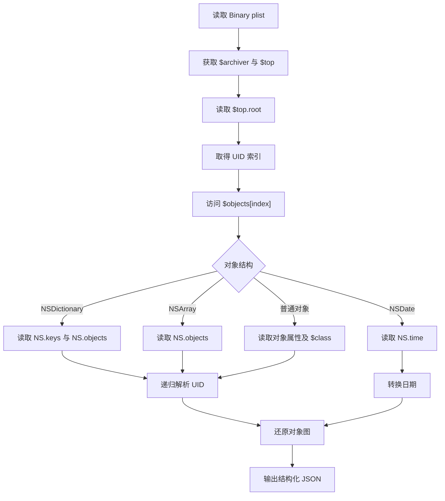
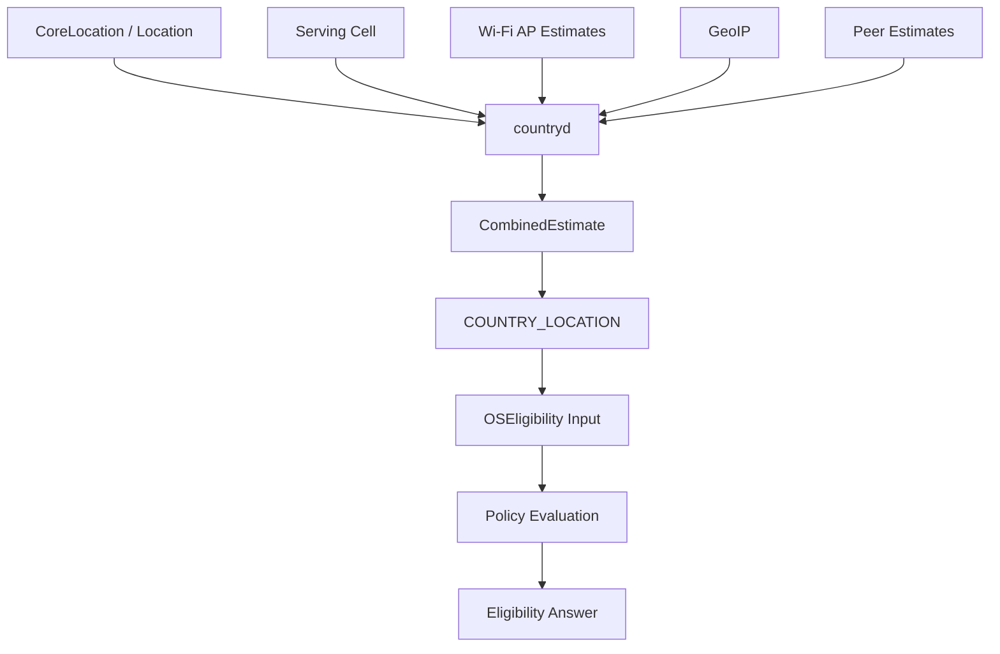
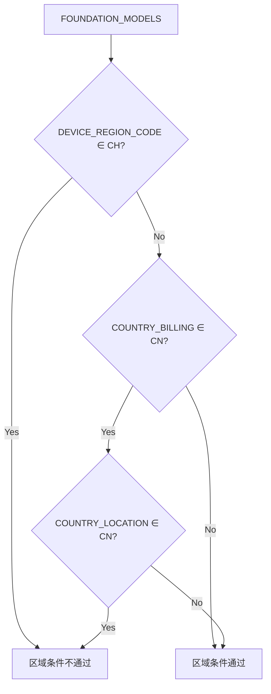
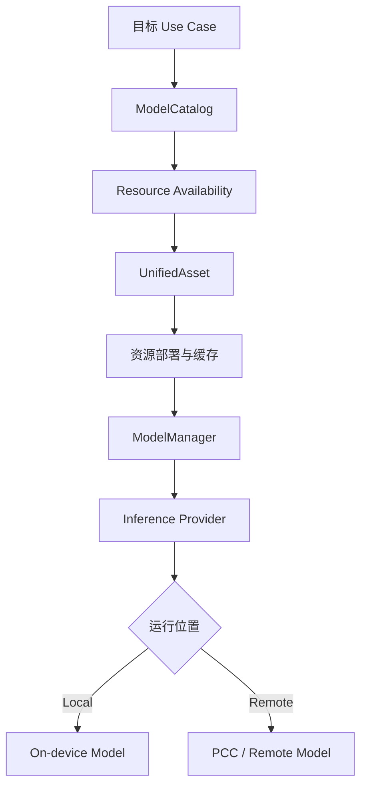
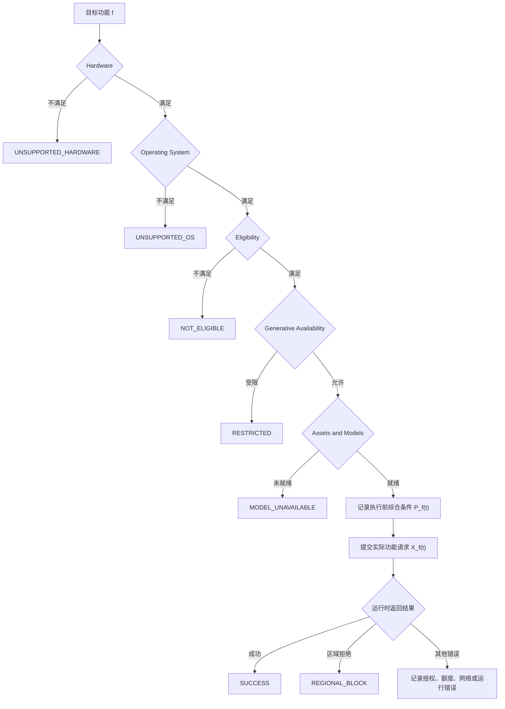
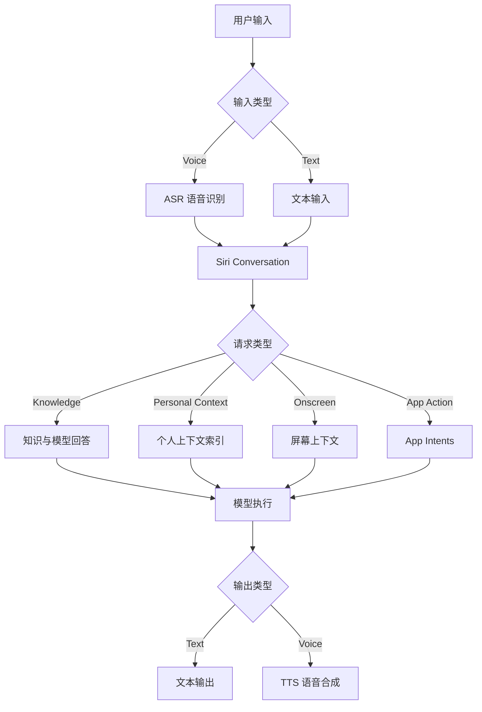
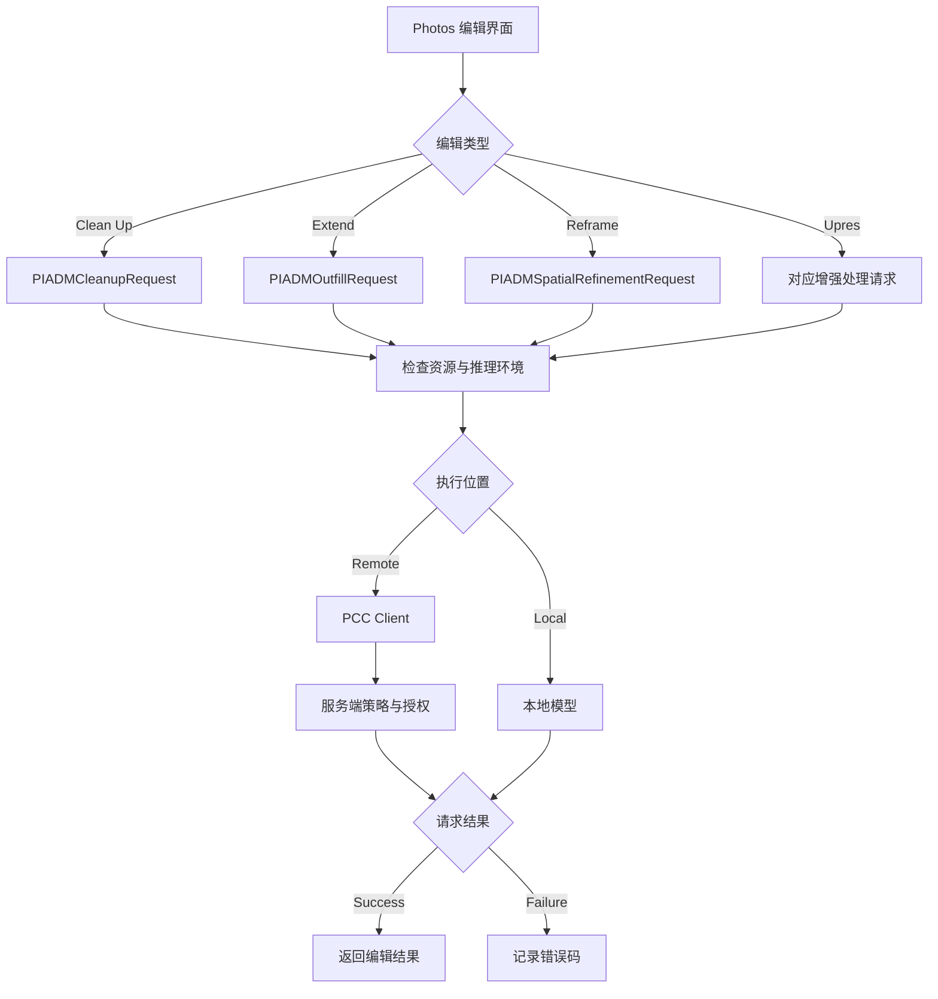
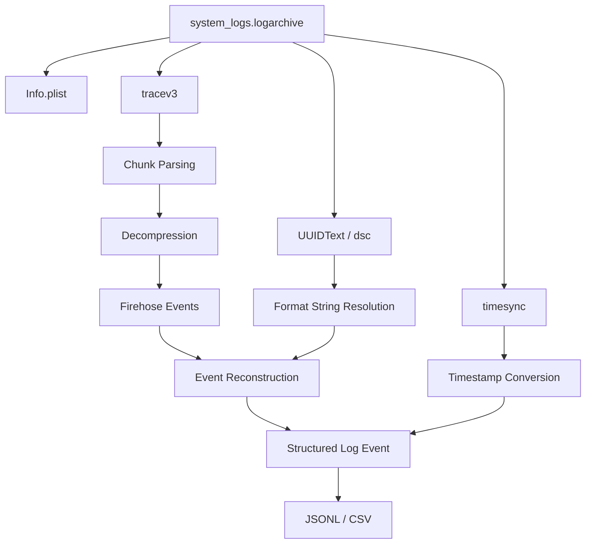
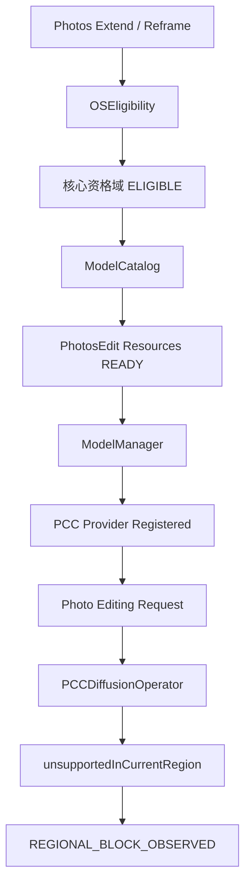
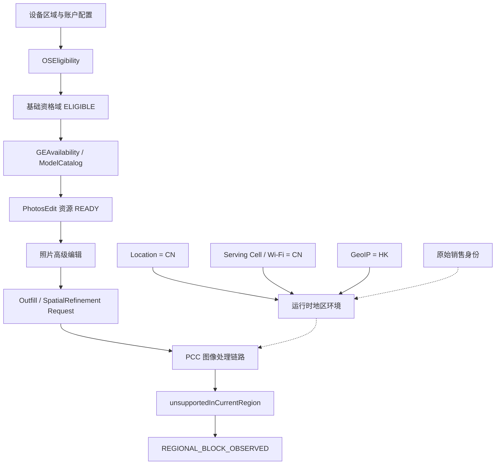

# 基于 iOS sysdiagnose 的 Apple Intelligence 区域资格、功能可用性及系统运行机制研究

*An Empirical Study of Apple Intelligence Eligibility, Regional Restrictions, Feature Availability, and Runtime Behavior Using iOS sysdiagnose*

<div align="center"><a href="https://github.com/Rainbow-SPY/AppleIntelligencePaperResearch/blob/main/PaperResearch_zh-CN.md">简体中文</a>   
  |  <a href="https://github.com/Rainbow-SPY/AppleIntelligencePaperResearch/blob/main/PaperResearch_en-US.md">English</a></div>

## 研究环境与适用范围

本文以研究者本人在中国大陆购买的 **iPhone 15 Pro Max**[^1] 为主要实验设备，采用真实设备操作、系统配置对照、sysdiagnose 原始数据解析及 Unified Logs 事件分析的方法开展研究。

**研究设备与软件环境如下：**

| 项目 | 研究配置 |
|---|---|
| 测试设备 | iPhone 15 Pro Max |
| 硬件型号 | `iPhone16,2` |
| 硬件区域型号 | `A3108`（对应中国大陆、香港及澳门的 iPhone 15 Pro Max；本机购于中国大陆） |
| 操作系统 | iOS 27.3 Developer Beta 1 |
| 系统 Build | `24C5037i` |
| 配置研究工具 | GestaltX、MobileGestalt 数据导出工具 |
| 设备区域研究 | `RegionCode`、`SalesRegion` 及相关缓存属性 |
| 账户环境 | 美国地区 Apple Account、App Store、媒体与购买项目 |
| 系统语言环境 | 英语、繁体中文及 Siri 语言组合 |
| 网络环境 | Wi-Fi、蜂窝网络、代理及不同网络出口 |
| 诊断来源 | sysdiagnose、GestaltX plist、模型目录、运行日志、异常报告 |
| 本地分析环境 | Windows；离线解析 plist、JSON、文本及 Unified Logs |
| 研究时间范围 | 2026 年 11 月 |
| 公开资料核对日期 | 2026 年 11 月 16 日 |

本文分析的是研究者在上述环境中的实际观测数据，其他机型或同型号设备的表现依其设备配置、系统版本、账户环境与运行条件而定。涉及系统测试版、设备参数修改、刷机及系统缓存操作的实验，可能产生数据丢失、设备识别异常、保修争议或系统无法正常运行等风险。本文同时区分官方公开规则、原始诊断事实与依据诊断资料建立的推理模型。

---

## 摘要

**研究目的：** 探究 Apple Intelligence 在 iOS 系统中的功能启用、区域资格、模型资源管理和实际推理执行机制，分析中国大陆销售设备的系统资格判定与运行时功能表现，并建立可供独立研究者及自动化分析程序复现的 sysdiagnose 解析方法。

**研究方法：** 采用实机对照实验、Property List（属性列表）解析、NSKeyedArchiver（键控对象归档）还原、Policy（资格策略）逻辑分析、Unified Logging（统一日志系统）解码和跨文件证据关联等方法，对设备配置、国家估计、系统资格、生成式功能状态、模型资源及运行错误进行分析。

**研究结果：** 研究者整理的核心诊断归档包含 1,136 个文件，其中 1,021 个属于系统日志归档。系统资格数据包含 222 个 Eligibility Domain（资格域）和 28 项资格输入；GEAvailability（生成式功能可用性）记录 63 项资源就绪的 Use Case（功能用例）；ModelCatalog（模型目录）包含 347 个资源可用性小节。研究发现部分 Apple Intelligence 功能可以实际完成操作，而照片扩展和空间重新构图在执行阶段出现 `PCCDiffusionOperatorError.unsupportedInCurrentRegion` 错误。国家位置识别、设备区域、账户地区及模型资源状态之间存在可明确区分的数据链路。

**研究结论：** Apple Intelligence 的可用性可通过硬件、操作系统、系统资格、功能授权、模型资源和运行时执行六个层级进行分析。完整解释某项功能的行为，需要将资格策略、资源快照和实际请求事件关联到同一条证据链。

**关键词：** Apple Intelligence；iOS 27；sysdiagnose；OSEligibility；MobileGestalt；countryd；GEAvailability；ModelCatalog；Private Cloud Compute；Unified Logging；区域资格

---

## 1. 引言

### 1.1 研究背景

Apple Intelligence 是苹果在操作系统中集成的生成式人工智能能力体系，涵盖 Siri AI、文本生成、图像生成、照片编辑、智能搜索、通知理解及应用内智能操作。

其运行过程涉及设备本地计算、系统资格判断、资源部署以及部分云端推理。苹果通过 Private Cloud Compute（私有云计算，PCC）处理部分计算密集型请求[^2]，并对依赖服务器端模型的功能设置使用条件和额度。[^3][^4][^5]

对于中国大陆销售设备，设备本身的计算能力、系统报告的资格状态、不同地区信息和实际功能执行结果构成了本研究的核心对象。

本研究采用实际运行记录与原始系统数据相互验证的方法，重点解释三个问题：**系统依据什么判断功能资格、具体功能由哪些组件提供、实际执行失败发生在哪个阶段。**

### 1.2 研究目标

本文建立四个相互关联的研究体系：

| 研究体系 | 核心问题 | 研究成果 |
|---|---|---|
| sysdiagnose 数据解析 | 数据存在哪里、采用什么格式、如何还原明文 | 目录、字段和编码索引 |
| 系统资格机制 | 设备、账户、地区、语言如何参与资格判断 | Eligibility Policy 逻辑模型 |
| Apple Intelligence 执行体系 | 功能如何关联模型、服务、PCC 和额度 | 六层可用性判定模型 |
| 实机证据分析 | 已启用功能与执行异常如何解释 | 多源证据关联与故障分类 |

### 1.3 研究设计与证据分级

本研究的实机资料包括 2026 年 11 月采集的基础 sysdiagnose、11 月 13 日的 Photos PCC 专项状态快照、两次 MobileGestalt 缓存导出及配套的功能操作记录。所有系统诊断路径在下文统一以**解压后的 sysdiagnose 根目录 `./`** 为基准；设备单独导出的配置和恢复日志在相应章节注明。

研究者通过设备识别及恢复日志核对 `ProductType = iPhone16,2`、系统版本 `iOS 27.3` 与 Build `24C5037i`；从实际操作中记录 Siri AI、图像生成、照片编辑及网络条件变化带来的功能表现。2026 年 11 月 13 日的专项状态快照用于对照片编辑相关资格和资源状态进行交叉复核。

技术解释采用 Apple 官方文档及公开的文件格式研究，并在相应论述处设置参考文献脚注。实机统计、功能结果和私有字段则在正文表格与附录中给出可检索的相对路径和原始键名。

本文使用以下证据分级：

| 证据级别 | 定义 |
|---|---|
| A：原始执行证据 | 解码日志中的请求类型、返回结果、错误代码及时间 |
| B：结构化系统状态 | OSEligibility、GEAvailability、ModelManager 等原始快照 |
| C：设备操作证据 | 实际功能操作成功或失败、系统显示状态 |
| D：技术推断 | 由多个证据源交叉关联得到的机制解释 |

---

## 2. sysdiagnose 数据集与文件组织结构

### 2.1 样本统计

以解压后的 sysdiagnose 根目录 `./` 为统计范围，递归枚举所有非目录文件，按第一级子目录归类，得到以下结果。

**表 1　核心 sysdiagnose 归档统计**

| 目录 | 文件数 | 主要内容 |
|---|---:|---|
| `system_logs.logarchive/` | 1,021 | 统一日志、字符串表、时间同步、统计文件 |
| `logs/` | 109 | 系统资格、国家估计、模型目录、资源配置 |
| `cr/` | 6 | Jetsam 和内存资源异常 |
| **总计** | **1,136** | 核心诊断资料 |

该归档包含 **66 个 `.tracev3` 文件**和 **1 个 `.timesync` 文件**。日志归档与其他系统状态快照共同构成此次研究的主要证据来源。

### 2.1.1 结构化数据的统计口径

以 sysdiagnose 根目录 `./` 为路径基准，文件总数按非目录条目计算；资格域、功能用例与模型目录则从解析后的原始对象和完整资源标识中统计。

**表 1-1　主要结构化诊断对象统计**

| 数据位置 | 统计对象 | 数量 |
|---|---|---:|
| `./logs/OSEligibility/state.plist` | `OS_ELIGIBILITY_STATE_DUMP_DOMAINS` 中的 Domain | 222 |
| 同上 | `OS_ELIGIBILITY_STATE_DUMP_INPUTS` 中的 Input | 28 |
| `./logs/GenerativeExperiences/GEAvailability.log` | `Assets ready` 字典中的不同 Use Case 键 | 63 |
| 同上 | `Unified Reasons` 字典中的 Use Case 键 | 2 |
| `./logs/ModelCatalog/model_catalog_dump.txt` | `Availability for ...:` 小节 | 347 |
| 同上 | 按完整标识字符串去重的资源标识 | 347 |

ModelCatalog 的资源标识可能包含功能、风格和配置后缀，例如 `VisualGeneration.GenerativePlayground:animation:animation`。统计时保留完整标识，因而每个配置变体均对应单独的资源条目。

### 2.2 目录组织

```text
sysdiagnose/
│
├── logs/
│   ├── OSEligibility/
│   ├── Country/
│   ├── GenerativeExperiences/
│   ├── ModelCatalog/
│   ├── ModelManager/
│   ├── UnifiedAsset/
│   ├── MobileAsset/
│   ├── Trial/
│   └── DeviceConfiguration/
│
├── system_logs.logarchive/
│   ├── Info.plist
│   ├── Persist/
│   ├── Special/
│   ├── Signpost/
│   ├── timesync/
│   ├── dsc/
│   ├── Extra/
│   └── 00/ ... FF/
│
└── cr/
    ├── JetsamEvent-*.ips
    └── me/
        └── *.lite_diag
```

补充采集的网络及服务诊断中，还包含 `./logs/Networking/`、`./summaries/` 与 `./crashes_and_spins/` 等位置，供网络、Siri 和异常分析使用。

Apple 的诊断文档将 sysdiagnose 用于收集系统状态、崩溃与近期日志；本研究从归档中的 `system_logs.logarchive` 提取运行证据。[^6][^7]

### 2.3 核心诊断文件与编码格式

**表 2　核心数据文件、用途和编码格式**

| 相对路径 | 研究内容 | 数据格式 |
|---|---|---|
| `logs/OSEligibility/state.plist` | 资格输入、Policy、资格答案 | XML plist |
| `logs/Country/countryCodeCache.plist` | 国家估计、位置来源 | Binary plist / NSKeyedArchiver |
| `logs/GenerativeExperiences/GEAvailability.log` | AI 功能状态、受限原因 | JSON |
| `logs/ModelCatalog/model_catalog_dump.txt` | 模型资源和可用配置 | 结构化文本 |
| `logs/ModelManager/model_manager_dump.json` | 推理提供者、资源、请求、会话 | JSON |
| `logs/UnifiedAsset/unified_asset_manager.log` | 资源部署、订阅、缓存、错误 | JSON |
| `logs/MobileAsset/history/*` | 资源下载与部署历史 | 文本日志 |
| `logs/Trial/*` | 功能灰度及实验策略 | 缩进文本 |
| `logs/DeviceConfiguration/**/*` | 系统及用户有效配置 | plist |
| `system_logs.logarchive/Info.plist` | 统一日志归档元数据 | XML plist |
| `system_logs.logarchive/Persist/*.tracev3` | 系统历史事件 | tracev3 |
| `system_logs.logarchive/timesync/*` | 日志时间同步 | 二进制 |
| `cr/JetsamEvent-*.ips` | 内存压力、进程终止 | JSON 诊断 |
| `cr/me/*.lite_diag` | 内存资源异常及堆栈 | Binary plist |

以下章节依次介绍上述文件的内部结构、解析技术及关联关系。

---

## 3. 原始数据编码与反序列化方法

### 3.1 Property List：系统配置数据的基本载体

Property List（属性列表，简称 plist）是 Apple 平台保存结构化数据的常见格式，其基本数据类型包括 Dictionary（字典）、Array（数组）、String（字符串）、Integer（整数）、Real（浮点数）、Boolean（布尔值）、Date（日期）和 Data（二进制数据）。[^8][^9]

plist 主要存在 XML 与 Binary 两种编码形式。二者可以表达相同的数据层级，但内部存储方式不同。[^8][^10]

**表 3　plist 格式识别方法**[^8][^11]

| 编码形式 | 文件头特征 | 解析方法 |
|---|---|---|
| XML plist | `<?xml`、`<plist>` | XML DOM、递归对象转换 |
| Binary plist | `bplist00` | 对象表、偏移表、引用索引 |
| Keyed Archive | plist 内包含 `$archiver` | 解析 UID 引用及对象关系 |

Binary plist 的基本组织如下：

```text
┌─────────────────────────────┐
│ Header: bplist00            │
├─────────────────────────────┤
│ Object Table                │
│ 对象内容、类型和引用          │
├─────────────────────────────┤
│ Offset Table                │
│ 各对象在文件中的位置          │
├─────────────────────────────┤
│ Trailer: 32 Bytes           │
│ 对象数量、索引长度和根对象     │
└─────────────────────────────┘
```

**表 4　Binary plist Trailer 字段**[^9]

| Trailer 相对偏移 | 长度 | 数据内容 |
|---|---|---|
| `0x06` | 1 Byte | `offsetIntSize` |
| `0x07` | 1 Byte | `objectRefSize` |
| `0x08–0x0F` | 8 Bytes | `numObjects` |
| `0x10–0x17` | 8 Bytes | `topObject` |
| `0x18–0x1F` | 8 Bytes | `offsetTableOffset` |

整数采用 Big Endian（大端字节序）表示。解析器首先读取 Trailer，再利用 Offset Table 定位对象，并根据 Object Table 内的类型信息完成递归还原。

### 3.2 NSKeyedArchiver：对象引用的还原

NSKeyedArchiver 是 Apple Foundation 框架提供的键控对象归档机制，用于保存具有引用关系的对象图，而不仅是简单的字典嵌套。[^11][^12][^10]

研究样本中的 `countryCodeCache.plist` 使用此机制。

其主要结构为：

```text
$archiver
$version
$top
$objects
```

例如：

```text
$top.root = UID(1)

$objects[1] = {
    LocalCountryEstimatesLocation: UID(2),
    LocalCountryEstimatesServingCell: UID(9),
    LocalCountryEstimatesWiFiAPs: UID(12),
    LocalCountryEstimatesGeoIP: UID(15),
    CombinedEstimate: UID(19)
}
```

此时 `UID(2)` 并非国家估计对象本身，而是对 `$objects[2]` 的引用。解析器需要继续访问该对象，再根据 `NS.objects`、`NS.keys` 和 `$class` 还原原有数据结构。

**图 1　NSKeyedArchiver 对象还原流程**[^12]



这一过程的技术重点是**对象身份、引用关系、数组顺序和类信息的恢复**。Apple 的归档规范对这些机制具有明确说明。[^10]

### 3.3 其他数据格式

**表 5　常见诊断文件解析方式**[^8][^13][^14]

| 数据类型 | 文件特征 | 处理方式 |
|---|---|---|
| JSON | 完整 `{}` 或 `[]` 结构 | JSON 反序列化 |
| JSONL | 每行一个 JSON 对象 | 逐行流式解析 |
| `.ips` | JSON 元数据和独立正文 | 分段解析 |
| `.lite_diag` | 部分样本为 `bplist00` | Binary plist 解析 |
| Trial 文本 | 缩进式 Policy / Factor 记录 | 按缩进恢复层级 |
| ModelCatalog 文本 | `Availability for ...` | 按资源标题分段 |
| MobileAsset 历史 | 时间戳与 `key=value` | 逐行键值解析 |
| `.tracev3` | Apple Unified Logging 二进制结构 | 日志块、字符串表与时间同步联合解析 |

---

## 4. 设备身份、区域及位置识别机制

### 4.1 多维地区输入

iOS 内部的地区信息来自不同数据源。为了研究资格系统与服务端授权，需要分别保存设备配置地区、销售地区、账户地区、国家位置和网络出口地区。

**表 6　研究设备的地区输入**

| 变量 | 实机记录 | 原始来源 |
|---|---|---|
| `DEVICE_REGION_CODE` | `ZA` | OSEligibility |
| `RegionCode` | `ZA` | MobileGestalt |
| `SalesRegion` | `ZA/A` | MobileGestalt |
| `COUNTRY_BILLING` | `US` | Apple 账户资格输入 |
| `COUNTRY_LOCATION` | `CN` | countryd / OSEligibility |
| `DEVICE_LOCALE` | `TW` | 系统本地化配置 |
| `SIRI_LANGUAGE` | `zh-TW` | Siri 语言输入 |
| `CHINA_CELLULAR` | `N` | OSEligibility |
| `PRECISE_LOCATION` | 空集合，confidence 2 | OSEligibility |

研究期间使用 GestaltX 导出设备修改前后的 MobileGestalt 状态并逐字节比较 `CacheData`。表中 OSEligibility 字段来自 `./logs/OSEligibility/state.plist`，位置估计来自 `./logs/Country/countryCodeCache.plist`。

### 4.2 MobileGestalt 地区缓存

MobileGestalt 是 Apple 系统用于提供设备能力、硬件特征及部分配置属性的机制。

研究者使用 GestaltX 导出其缓存数据，主要对象为：

```text
CacheUUID
CacheVersion
CacheData
CacheExtra
GestaltXDeviceProof
```

其中 `CacheExtra` 使用哈希化的属性键。

**表 7　研究样本中已确认的字段映射**

| CacheExtra Key | 字段名称 | 研究用途 |
|---|---|---|
| `h63QSdBCiT/z0WU6rdQv6Q` | `RegionCode` | 设备区域配置 |
| `yK+xavymRGZ3xWc1tb8XDg` | `SalesRegion` | 销售地区配置 |
| `xNN67KktpWp7syTT3S1BFA` | `ProductType` | 硬件型号 |

`CacheData` 保存二进制缓存内容。在前后两份导出中，研究者观察到两个字节发生变化。

**表 8　CacheData 差异**

| 相对偏移 | 早期导出 | 后期导出 |
|---|---|---|
| `0xBF8` | `0x01` | `0x00` |
| `0xFD0` | `0x00` | `0x01` |

这两个偏移曾被用于研究 `green-tea`、`not-green-tea` 等区域相关缓存标记。当前可直接确认的是缓存字节差异；具体标记名称与偏移之间的映射仍需要针对 `iPhone16,2` 的缓存布局验证。

### 4.3 countryd：国家位置估计

countryd 是系统国家估计机制，负责收集定位、蜂窝、Wi-Fi、IP 等来源提供的国家信息。[^15][^16]

**原始文件：**

```text
.\logs\Country\countryCodeCache.plist
```

研究样本中的 NSKeyedArchiver 根对象为 `RDCachedData`，内部存储多个 `RDEstimate` 对象。

**表 9　countryd 国家估计**

| 来源 | 字段 | 国家结果 | Priority |
|---|---|---|---|
| 定位 | `LocalCountryEstimatesLocation` | `CN` | 4 |
| 当前服务基站 | `LocalCountryEstimatesServingCell` | `CN` | 2 |
| Wi-Fi 接入点 | `LocalCountryEstimatesWiFiAPs` | `CN` | 1 |
| 公网 IP | `LocalCountryEstimatesGeoIP` | `HK` | 5 |
| 附近基站 | `LocalCountryEstimatesNearbyCells` | 无记录 | — |
| 其他设备估计 | `PeerEstimates` | 空对象 | — |
| 综合国家估计 | `CombinedEstimate` | `CN` | — |
| 上次综合结果 | `LastKnownCombinedEstimate` | `CN` | — |

每条 `RDEstimate` 记录包含 `CountryCode`、`Priority`、`Timestamp` 和 `Disputed`。[^17]

其中 `Priority` 是归档中的优先级属性。`CombinedEstimate` 是系统保存的组合结果，实际合成算法需要结合 `countryd` 的实现及运行时记录研究。

### 4.4 国家估计与资格输入的关系

**图 2　countryd 国家估计与资格输入链路**



账户国家和设备地区则通过各自的输入渠道参与资格计算。

相关数据可统一表示为：

$$
\mathcal{R} =
\{
R_{\mathrm{device}},
R_{\mathrm{sales}},
R_{\mathrm{billing}},
R_{\mathrm{location}},
R_{\mathrm{IP}}
\}
$$

其中各变量代表独立的地区信号。


### 4.5 DeviceConfiguration：系统和用户配置快照

系统有效配置位于 `./logs/DeviceConfiguration/{System,User}/EffectiveConfigurations/`，按配置命名空间分组。单个命名空间的 `EffectiveConfiguration/` 目录主要包含：

| 文件 | 可读取信息 |
|---|---|
| `EffectiveValues.plist` | 当前生效的配置值与设置项 |
| `EffectivePriorities.plist` | 对应值的优先级 |
| `EffectiveBlame.plist` | 该配置值的来源或归因信息 |

可通过递归枚举 `com.apple.<Namespace>`，将三个 plist 中的键按相同字段路径关联。研究样本涉及 `com.apple.modelcatalog`、`com.apple.AudioIntelligence` 等命名空间。

---

## 5. OSEligibility 系统资格判定

### 5.1 数据结构

OSEligibility 是研究 Apple Intelligence 区域限制的主要数据来源之一。

**原始文件：**

```text
.\logs\OSEligibility\state.plist
```

本次采集的 `state.plist` 为 XML plist。解析 `OS_ELIGIBILITY_STATE_DUMP_DOMAINS` 可枚举 **222 个资格域**；解析 `OS_ELIGIBILITY_STATE_DUMP_INPUTS` 可枚举 **28 项输入**，并可在 `OS_ELIGIBILITY_STATE_DUMP_LAST_ANSWERS` 获取各 Domain 的状态快照。根对象包含七项主要数据。

| 根字段 | 数据内容 |
|---|---|
| `OS_ELIGIBILITY_STATE_DUMP_DOMAINS` | Domain 名称、原始 Policy 表达式 |
| `OS_ELIGIBILITY_STATE_DUMP_GLOBAL_STATE` | 全局资格状态 |
| `OS_ELIGIBILITY_STATE_DUMP_INPUTS` | 资格输入对象的描述 |
| `OS_ELIGIBILITY_STATE_DUMP_INPUT_OVERRIDES` | 输入覆盖 |
| `OS_ELIGIBILITY_STATE_DUMP_LAST_ANSWERS` | 最后一次计算的答案及条件状态 |
| `OS_ELIGIBILITY_STATE_DUMP_MOBILE_ASSET` | 资格相关资源信息 |
| `OS_ELIGIBILITY_STATE_DUMP_OVERRIDES` | Domain 级覆盖信息 |

**重要的数据表示特征：** `INPUTS` 内不少值是 Objective-C 对象的文字描述，例如 `LocatedCountryInput`、`CountryBillingInput`，而 `DOMAINS` 中的 Policy 也是嵌套表达式文本。`LAST_ANSWERS` 则提供相对规整的结构化字典。

### 5.2 全部 28 项资格输入

**表 10　OSEligibility 输入字段分类**

| 输入类别 | 原始字段 |
|---|---|
| 国家及地区 | `COUNTRY_BILLING`、`COUNTRY_LOCATION`、`PRECISE_LOCATION`、`INITIAL_SETUP_LOCATION`、`SHIPTO_LOCATION`、`DEVICE_REGION_CODE`、`DEVICE_LOCALE` |
| 设备能力 | `DEVICE_CLASS`、`DEVICE_TYPE`、`CELLULAR_CAPABLE_DEVICE`、`CHINA_CELLULAR`、`GENERATIVE_MODEL_SYSTEM`、`HAS_LINWOOD` |
| Siri 与语言 | `DEVICE_LANGUAGE`、`SIRI_LANGUAGE`、`DEVICE_AND_SIRI_LANGUAGE_MATCH`、`DEVICE_SIRI_MODE` |
| 系统环境 | `EXTERNAL_BOOT_DRIVE`、`SHARED_IPAD`、`GREYMATTER_ON_QUEUE`、`PHONE_APP_REMOVAL` |
| 年龄及账户 | `AGE_ASSURANCE_AREA_ID`、`BIRTHDATE`、`IS_CHILD`、`IS_TEEN`、`IS_AGE_VERIFIED_ADULT`、`IS_ACCOUNT_ELIGIBILE_FOR_AGE_ASSURANCE`、`IS_CONNECTED_TO_AGE_VERIFIED_ADULT` |

所有字段在 `INPUTS` 中使用 `OS_ELIGIBILITY_INPUT_` 前缀。

例如：

```text
OS_ELIGIBILITY_INPUT_COUNTRY_LOCATION
OS_ELIGIBILITY_INPUT_DEVICE_REGION_CODE
OS_ELIGIBILITY_INPUT_SIRI_LANGUAGE
```

### 5.3 Policy 表达式

OSEligibility 的资格判定通过嵌套策略进行。

**表 11　Policy 语法**

| Policy | 定义 |
|---|---|
| `InputPolicy` | 对指定输入执行比较 |
| `AndPolicy` | 所有子条件同时满足 |
| `OrPolicy` | 任一子条件满足 |
| `NotPolicy` | 子条件取反 |
| `inArray` | 单个输入属于指定集合 |
| `anyInArray` | 数组输入至少有一个元素属于指定集合 |
| `AISupportedLanguagesPolicy` | 执行设备与 Siri 语言资格检查 |
| `GracePeriodPolicy` | 应用宽限期状态与时间规则 |
| `notSetAnswer` | 输入未设置时采用的指定答案 |
| `isControlFlow` | 标记策略节点的控制流语义 |

资格计算可表示为：

$$
E_D=\operatorname{Eval}(Policy_D,Inputs)
$$

其中 \(D\) 表示某个资格域。

### 5.4 FOUNDATION_MODELS 区域策略

研究样本中，`FOUNDATION_MODELS`（Domain 130）存在如下策略：

```text
NotPolicy(
    OrPolicy(
        DEVICE_REGION_CODE inArray(CH),
        AndPolicy(
            COUNTRY_BILLING inArray(CN),
            COUNTRY_LOCATION anyInArray(CN)
        )
    )
)
```

定义：

$$
R=[DEVICE\_REGION\_CODE\in\{CH\}]
$$

$$
B=[COUNTRY\_BILLING\in\{CN\}]
$$

$$
L=[COUNTRY\_LOCATION\in\{CN\}]
$$

得到：

$$
E_{\mathrm{FoundationRegion}}
=\neg\left(R\lor(B\land L)\right)
$$

该表达式包含两条区域判断分支：设备区域匹配，以及账单国家和当前位置的联合匹配。Policy 原文位于 `./logs/OSEligibility/state.plist` 的 `OS_ELIGIBILITY_STATE_DUMP_DOMAINS["FOUNDATION_MODELS"]`；相应求值结果位于 `OS_ELIGIBILITY_STATE_DUMP_LAST_ANSWERS["FOUNDATION_MODELS"]`。

**图 3　FOUNDATION_MODELS 区域资格链路**



### 5.5 主要 Apple Intelligence 资格域

**表 12　核心 Domain 与样本计算结果**

| Domain | 编号 | 研究内容 | 答案 |
|---|---|---|---|
| `GREYMATTER` | 122 | Apple Intelligence 基础能力 | `ELIGIBLE` |
| `AMERICIUM` | 96 | 智能服务及 Siri 相关能力 | `ELIGIBLE` |
| `SIRI_MODE` | 155 | Siri 模式资格 | `ELIGIBLE` |
| `FOUNDATION_MODELS` | 130 | Foundation Models 资格 | `ELIGIBLE` |
| `SIRI_WITH_APP_INTENTS` | — | Siri 应用操作资格 | `ELIGIBLE` |
| `DUBNIUM` | 106 | Watch 相关资格 | `NOT_ELIGIBLE` |

其中 `GREYMATTER`、`AMERICIUM` 和 `SIRI_MODE` 的 Policy 包括设备类别、语言、Siri 状态、区域条件及其他能力检查。

例如，`SIRI_MODE` 的 `LAST_ANSWERS` 中可观察到：

```text
COUNTRY_BILLING       = ELIGIBLE
COUNTRY_LOCATION      = NOT_ELIGIBLE
DEVICE_REGION_CODE    = ELIGIBLE
SIRI_LANGUAGE         = ELIGIBLE

Final Answer          = ELIGIBLE
```

最终答案由对应 Domain 的完整 Policy 树决定。

### 5.6 其他地区及监管资格域

**表 13　地区与监管策略**

| Domain | 主要判断逻辑 | 样本答案 |
|---|---|---|
| `LANTHANUM` | `COUNTRY_LOCATION ∈ CN` | `ELIGIBLE` |
| `AI_LABELING` | `REGION ∈ CH OR (BILLING ∈ CN AND LOCATION ∈ CN)` | `NOT_ELIGIBLE` |
| `XENON` | 多地区排除及 `GracePeriodPolicy` | `NOT_ELIGIBLE` |
| `CALCIUM` | 设备类别、`REGION=CH`、`CHINA_CELLULAR` | `NOT_ELIGIBLE` |
| `FLEROVIUM` | 位置或账单国家属于 US、GB | `ELIGIBLE` |
| `RUBIDIUM` | 设备地区排除和账单地区白名单 | `ELIGIBLE` |

年龄保证系统还使用：

```text
ADULT_AGE_VERIFICATION_REQUIRED
AGE_ASSURANCE_JURISDICTION_LIFECYCLE
AGE_ASSURANCE_REGULATORY_FEATURES
MOLYBDENUM
```

主要涉及年龄保证地区、精确位置、出生日期、账户年龄状态及家长管理资格。

---

## 6. Apple Intelligence 六层功能可用性模型

### 6.1 模型定义

本研究将 Apple Intelligence 功能诊断划分为**执行前条件检查（Pre-execution Validation）**和**运行时执行（Runtime Execution）**两个阶段。

对于目标功能 \(f\) 与观测时刻 \(t\)，执行前综合条件定义为：

$$
P_f(t)=H_f(t)\land O_f(t)\land E_f(t)\land G_f(t)\land A_f(t)
$$

| 符号 | 完整名称 | 研究含义 |
|---|---|---|
| \(H_f\) | Hardware Capability（硬件能力） | 设备型号及目标功能的硬件条件 |
| \(O_f\) | Operating System Compatibility（操作系统兼容性） | 系统版本、语言与配置 |
| \(E_f\) | Feature Eligibility（功能资格） | OSEligibility 相关 Domain 的策略结果 |
| \(G_f\) | Generative Availability（生成式功能可用性） | GEAvailability 的功能级状态 |
| \(A_f\) | Asset and Model Readiness（资源与模型就绪） | 模型、依赖资产及推理提供者状态 |
| \(P_f\) | Pre-execution Conditions（执行前综合条件） | 以上执行前条件的组合 |

运行时执行定义为：

$$
X_f(t)=\operatorname{Execute}(f,\operatorname{Context}_t)
$$

其中 \(\operatorname{Context}_t\) 包括实际请求发生时的网络、地区、账户、服务、请求参数及运行环境。执行结果 \(R_f(t)\) 按原始事件归类为：

$$
R_f(t)\in\{
\mathrm{SUCCESS},\,
\mathrm{REGIONAL\_BLOCK},\,
\mathrm{ACCESS\_DENIED},\,
\mathrm{QUOTA\_EXCEEDED},\,
\mathrm{MODEL\_ERROR},\,
\mathrm{NETWORK\_ERROR},\,
\mathrm{RUNTIME\_ERROR},\,
\mathrm{UNKNOWN}
\}
$$

各层同时记录原始状态、时间戳、文件路径与功能标识，供跨文件证据关联。

### 6.2 Hardware：硬件条件

在 iOS 27 中，Apple Intelligence 支持 iPhone 15 Pro、15 Pro Max、iPhone 16 系列及后续兼容机型。部分高级能力另有更高的设备要求。[^3][^4][^1][^3]

研究所需的硬件字段主要有：

| 字段 | 判断用途 |
|---|---|
| `ProductType` | 确定实际硬件型号 |
| `DEVICE_CLASS` | 判断平台类别 |
| `DEVICE_TYPE` | 判断特定硬件类别 |
| `GENERATIVE_MODEL_SYSTEM` | 判断生成模型系统能力 |
| `HAS_LINWOOD` | 检查 Linwood 能力状态 |
| `DEVICE_SIRI_MODE` | 检查 Siri 模式配置 |

### 6.3 Operating System：系统环境条件

操作系统检查由以下因素组成：[^3][^4]

$$
O_F=
OS_F\land Language_F\land Configuration_F
$$

其中：

| 条件 | 数据 |
|---|---|
| 系统支持 | iOS 版本、Build、目标功能最低要求 |
| 语言支持 | `DEVICE_LANGUAGE`、`SIRI_LANGUAGE` |
| 语言匹配 | `DEVICE_AND_SIRI_LANGUAGE_MATCH` |
| 功能配置 | Siri 模式、系统设置、相关框架 |
| 资源空间 | 目标模型所需的设备存储空间 |

Apple 的 iOS 27 文档要求设备语言和 Siri 语言满足支持条件。Siri AI Beta 另有独立的语言、账户区域及功能支持要求。[^3][^4]

### 6.4 Eligibility：系统资格条件

`E_F` 主要来自 `state.plist` 的 Domain Policy 和 `LAST_ANSWERS`。

资格域的完整计算路径为：

```text
目标功能
    ↓
关联 Eligibility Domain
    ↓
读取 Policy
    ↓
加载 Input
    ↓
执行 And / Or / Not / GracePeriod
    ↓
计算 Eligibility Answer
```

对多个资格域构成的功能，可进一步定义：

$$
E_F=\operatorname{PolicyCombine}(E_{D_1},E_{D_2},\ldots,E_{D_n})
$$

其中 `PolicyCombine` 由目标功能的实际资格策略确定。

### 6.5 Generative Availability：功能级准入

**原始文件：**

```text
.\logs\GenerativeExperiences\GEAvailability.log
```

该文件是完整 JSON。

核心路径：

```text
availability
  .cached
  .useCaseBlockList
```

下级包含：

```text
Assets ready
Unified Reasons
Policy limited
Access not granted
Updated since boot
```

研究样本中有 63 项 `Assets ready` 记录，另外两个 Partner Use Case 包含原因信息。

| Use Case | 原始原因 |
|---|---|
| `com.apple.Settings.AppleIntelligence.Partner.ChatGPT` | `useCaseDoesNotAllowCurrentIPCountryCode` |
| `com.apple.Settings.AppleIntelligence.Partner.Snowflake` | `partnerNotSelected` |

第一条反映功能级 IP 国家限制；第二条表示对应伙伴未被选择。

这两条记录展示了功能策略中**地区拒绝**和**伙伴配置状态**两种不同的判定结果。

### 6.5.1 ChatGPT 扩展的阶段性状态

2026 年 11 月 12 日采集的 GEAvailability 快照包含以下限制原因：

```text
availability.cached.useCaseBlockList
  ["Unified Reasons"]
  ["com.apple.Settings.AppleIntelligence.Partner.ChatGPT"]
  [0].restricted._0
  .useCaseDoesNotAllowCurrentIPCountryCode
```

该字段对应 ChatGPT Partner 的 IP 国家代码限制。后续实机操作中，研究者成功连接并绑定 ChatGPT 扩展。

| 实验阶段 | 证据来源 | 观测结果 |
|---|---|---|
| 初始快照（2026-11-12） | `./logs/GenerativeExperiences/GEAvailability.log` | `useCaseDoesNotAllowCurrentIPCountryCode` |
| 后续功能操作 | 实机 ChatGPT 扩展界面 | 连接、绑定成功 |

关联分析所需数据包括两次操作的网络出口、Partner Use Case 状态、请求时间及对应服务日志。

### 6.6 Assets & Models：模型和资源

模型资源检查涉及三个主要组件。实机的 `./logs/ModelCatalog/model_catalog_dump.txt` 包含 **347 个**以 `Availability for` 开始的可用性小节，按完整标识去重后仍为 **347 个资源标识**。每个小节分别保存 `ready for` 条件及相关资源信息。

**ModelCatalog** 记录某个 Use Case 或模型组是否能获得相应资源。在 `PhotosEdit.Outfill.1p` 等资源小节中，`ready for: ["(all,all)"]` 表示模型目录对所列配置报告就绪。

**ModelManager** 记录模型资产、推理提供者、模型请求和会话。

**UnifiedAsset** 记录资源下载、部署、缓存和订阅状态。

三者之间的关系为：

**图 4　模型资源与推理提供者链路**



模型管理器中的推理提供者可以通过 `inferenceProviders[].descriptor.id` 识别。

研究样本中存在：

```text
pcc-agent-client
```

并出现：

```text
hostedOnServer = true
```

与远程模型组相关的资源包括 `noise_predictor`、`vae_encoder`、`vae_decoder`、`textencoder` 等。

### 6.7 Execution：运行时执行

实际请求可能经过本地模型或远程推理服务。[^5][^18]

PCC 的运行架构涉及经过验证的计算节点、请求加密、软件证明及云端模型执行。[^2]苹果在 Private Cloud Compute 安全研究中详细介绍了该体系的设计与处理流程。[^5]

执行状态可以表示为：

$$
X_f(t)=\operatorname{Execute}(f,\operatorname{Context}_t)
$$

其中 `Context_t` 表示请求发生时的设备、网络和服务环境。

**图 5　Apple Intelligence 执行前条件与运行时执行链路**



---

## 7. Apple Intelligence 的功能、资源与执行路径

### 7.1 功能组划分

研究根据用户可见功能和系统内部用例，将 Apple Intelligence 分为以下类别。

**表 14　主要功能组**[^3][^4]

| 功能类别 | 用户可见能力 | 主要内部用例或资源 |
|---|---|---|
| Siri AI | 智能对话、个人上下文、屏幕理解 | `Siri.Conversation`、Siri 相关服务 |
| 写作工具 | 改写、校对、摘要、智能回复 | `textComposition.*` |
| 图乐园 | 文本生成图片、个性化图片 | `ImagePlayground.Creation.*` |
| Genmoji | 根据描述生成表情 | `VisualGeneration.KeyboardEmojiGenerator` |
| Image Wand | 手绘及上下文图像生成 | `handwriting.synthesis` |
| 照片编辑 | 消除、扩展、空间重构、增强 | `PhotosEdit.*` |
| 邮件和信息 | 摘要、分类、智能回复 | `summarization.*`、`classification.*` |
| 通知 | 摘要和优先级识别 | Notification Use Case |
| 视觉智能 | 图像内容理解 | `VisualIntelligence.*` |
| 快捷指令 | AI 生成操作及模型调用 | App Intents、Foundation Models |
| 第三方扩展 | ChatGPT 等伙伴服务 | `Partner.*` |

### 7.2 Siri AI 的执行结构

Siri AI 的研究对象包括语音识别、对话管理、上下文获取、应用操作、模型推理及语音输出。[^4][^19][^20]

**图 6　Siri AI 处理链路**



ASR（Automatic Speech Recognition，自动语音识别）将语音转换为文本；TTS（Text-to-Speech，文本转语音）则负责将最终输出转换为语音。

对于 App Intents，Siri 需要将自然语言请求映射到应用提供的操作接口，并执行相应的参数及权限检查。[^19]

### 7.3 图像生成与照片编辑

照片高级编辑是本次研究中最重要的实际故障对象。[^3]

ModelCatalog 中确认存在四项主要资源：

**表 15　PhotosEdit 资源状态**

| 资源标识 | 用户功能 | ModelCatalog |
|---|---|---|
| `PhotosEdit.Infill.1p` | 图片内容填充 | `READY` |
| `PhotosEdit.Outfill.1p` | 画面扩展 | `READY` |
| `PhotosEdit.SpatialReframing.1p` | 空间重构 | `READY` |
| `PhotosEdit.Upres.1p` | 图像增强 | `READY` |

四项均包含：

```text
ready for: ["(all,all)"]
```

另有本地消除相关资源：

```text
com.apple.fm.photos.genedit.magiccleanup
```

该资源可用于分析本地 Magic Cleanup 的模型部署和执行路径。

### 7.4 Photos PCC 执行流程

**图 7　照片编辑请求处理链路**[^5]



### 7.5 已观察到的实际运行结果

下表是研究者本人对设备进行实际操作后的记录，包含启动、交互、生成与执行结果；测试结果与后续解码日志中的对应请求相互校验。

**表 16　实机功能验证结果**

| 功能 | 用户实测 |
|---|---|
| Siri AI Beta | 可进入并进行部分实际对话 |
| Siri 繁体中文文字交互 | 成功 |
| Siri 日期查询 | 成功 |
| Siri 天气查询 | 无代理时失败，代理开启后恢复 |
| Siri ChatGPT 扩展 | 后续测试中成功连接和绑定 |
| Image Playground | 成功生成图片 |
| Genmoji | 成功生成表情 |
| Image Wand | 可正常操作 |
| Photos 自然语言搜索 | 可用 |
| Photos 快速消除 | 可用 |
| Photos 高精度消除 | 执行失败 |
| Photos Extend | 执行失败 |
| Photos Reframe | 执行失败 |
| Siri Camera | 未成功使用 |
| Math Notes | 可进行手写公式计算 |

### 7.6 区域拒绝错误分析

在统一日志的照片编辑执行记录中，发现：

```text
PCCDiffusionOperatorError.unsupportedInCurrentRegion
```

对应请求包括以下类型。原始执行记录可在 `./system_logs.logarchive/Persist/*.tracev3` 解码结果中按请求名及错误名检索；本次实际匹配到的持久化日志文件尾号包括 `25ff`、`2603` 和 `260b`。

```text
PIADMOutfillRequest
PIADMSpatialRefinementRequest
```

部分请求多次出现相同错误。

该错误位于 PCC 图像生成处理链路中，是本研究确定照片扩展与空间重构执行失败性质的关键证据。

结合其他数据：

| 证据来源 | 观察结果 |
|---|---|
| OSEligibility | 核心 AI 资格域允许 |
| ModelCatalog | PhotosEdit 四项资源 READY |
| ModelManager | 存在 PCC 推理提供者 |
| countryd | 综合国家估计为 CN |
| Unified Logs | Extend / Reframe 遭遇区域拒绝 |

由此可将这两项功能的故障主要定位到**运行时区域准入阶段**。高精度消除的最终拒绝原因仍需要对应的独立执行事件确认。

---

## 8. 其他系统诊断模块

### 8.1 Network Diagnostics：网络诊断

网络诊断主要用于恢复设备的网络接口、DNS、代理、VPN、蜂窝与路由状态。[^21]

**表 17　网络文件及读取内容**

| 文件 | 主要信息 |
|---|---|
| `Networking/ifconfig.txt` | 网络接口、IPv4、IPv6、MTU |
| `Networking/get-network-info.txt` | 网络服务摘要 |
| `Networking/route-info.txt` | 路由、网关、网络出口 |
| `Networking/NetworkInterfaces.plist` | 网络接口配置 |
| `Networking/preferences.plist` | 网络服务及偏好设置 |
| `Networking/com.apple.networkextension.plist` | Network Extension 状态 |
| `Networking/com.apple.networkextension.necp.plist` | NECP 网络策略 |
| `summaries/NSURLSession_logs.log` | URLSession 日志采集信息 |

主要关注：

```text
HTTPProxy
HTTPSProxy
SOCKSProxy
ProxyAutoConfigURLString
ServerAddresses
nameserver
gateway
utun
pdp_ip
en0
```

NECP（Network Extension Control Policy，网络扩展控制策略）与 Network Extension 的记录可用于分析特定应用或系统服务的网络流量策略。[^21][^22]

### 8.2 Trial：功能灰度与实验

Trial 是 Apple 系统中用于配置功能发布、实验参数与实验分组的机制之一。

主要文件：

```text
logs/Trial/trial-rollout-info.log
logs/Trial/trial-experiment-info.log
logs/Trial/trial-pcc-experiment-info.log
logs/Trial/trial-server-side-experiment-info.log
logs/Trial/trial-experiment-history.log
```

主要字段：

| 字段 | 研究含义 |
|---|---|
| `rollout` | 功能灰度配置 |
| `status` | 灰度状态 |
| `namespace` | 参数所属命名空间 |
| `factor` | 实验参数 |
| `levelValue` | 参数实际取值 |
| `experiment` | 实验标识 |
| `treatment` | 实验分组 |
| `factorPackId` | 参数包标识 |

这类信息适合按缩进文本解析，恢复 Rollout、Namespace 和 Factor 之间的父子关系。

### 8.3 MobileAsset 与 UnifiedAsset

MobileAsset 负责系统资源的获取、更新及部署管理。

通过 `./logs/MobileAsset/history/MAAutoAsset_*_History_*.log` 中的键值记录可提取：

```text
time
op
client
set
error_domain
error_code
error_desc
targetOSVersion
targetBuild
```

`./logs/UnifiedAsset/unified_asset_manager.log` 使用 JSON 编码，根对象保存：

```text
AssetSetConfiguration
AssetSetIdentifiers
AssetSetTokens
PersistedAssetInfo
SystemAssets
Subscriptions
Errors
```

二者能够共同描述一个模型资产的下载历史、当前缓存状态和部署结果。

### 8.4 Jetsam 与内存资源异常

Jetsam 是 iOS 内存压力及进程资源管理机制的重要部分。[^14][^23]

典型文件：

```text
cr/JetsamEvent-*.ips
cr/me/*.lite_diag
```

JetsamEvent 包含进程状态、资源页数、内存状态及终止原因等数据。

Memory Resource Exception 文件则可包含：

```text
MRE_PID
MRE_PPID
MRE_ExecName
MRE_ExecPath
MRE_ExceptionType
MRE_LimitValue
MRE_LedgerPhysFootprint
MRE_LedgerPhysFootprintPeak
MRE_ExecutionStack
```

研究过程中，在 `./cr/me/*.lite_diag` 以及单独收集的 `agentstored` 内存资源异常中发现 `per-process-limit` 类型的终止记录，可通过 `MemoryResourceExceptionMetaData.MRE_ExceptionType` 与 `MRE_ExecName` 定位。对应 JetsamEvent 中记录的驻留内存约为 9.48 MiB。

该类事件可用于研究 Siri 相关后台服务的资源限制、进程生命周期及运行稳定性。

---

## 9. Unified Logging：系统运行事件的还原

### 9.1 统一日志的组织

Unified Logging 是 Apple 平台的统一日志系统，负责记录系统服务、应用进程、性能事件及运行错误。[^13][^24]

日志以压缩二进制形式保存，需要将事件、格式字符串和运行时间信息组合还原。[^25][^26][^13]

研究归档中的主要结构：

```text
system_logs.logarchive/
├── Info.plist
├── Persist/
│   └── *.tracev3
├── Special/
│   └── *.tracev3
├── Signpost/
│   └── *.tracev3
├── timesync/
│   └── *.timesync
├── 00/ ... FF/
│   └── UUIDText 数据
├── dsc/
└── Extra/
    ├── logdata.statistics.*.jsonl
    ├── logd.*.log
    └── diagnosticd.*.log
```

### 9.2 tracev3 的主要数据结构

`.tracev3` 由多个二进制块组成，主要涉及：[^25][^26]

| 组件 | 作用 |
|---|---|
| Header | 系统及日志头信息 |
| Catalog | 进程、子系统及相关引用信息 |
| ChunkSet | 压缩或封装的事件数据块 |
| Firehose | 日志事件及参数 |
| UUIDText | 日志格式字符串 |
| DSC | Shared Cache 字符串数据 |
| timesync | 连续时间与实际时间对应关系 |

目录 `00` 至 `FF` 主要与 UUIDText 文件的 UUID 路径组织有关。[^25]

### 9.3 时间同步

Unified Logs 中的事件常使用 Mach Continuous Time（Mach 连续时间），需要通过 timesync 数据还原为实际时间。[^25]

其计算可概括为：

$$
T_{\mathrm{wall}}
=
T_{\mathrm{sync}}
+
\left(
T_{\mathrm{event}}-T_{\mathrm{reference}}
\right)
\cdot
\frac{Numerator}{Denominator}
$$

其中 `Numerator` 和 `Denominator` 表示时间基准的转换比例。

### 9.4 日志解码流程

**图 8　Unified Logging 解码流程**[^25][^26]



恢复后的统一事件结构建议包含：

```json
{
  "Timestamp": "...",
  "Process": "...",
  "ProcessID": 0,
  "Subsystem": "...",
  "Category": "...",
  "MessageType": "...",
  "EventMessage": "...",
  "SourceTraceV3": "..."
}
```

### 9.5 Windows 上的日志解析

本研究的分析平台为 Windows，核心实现为 C#/.NET 10，使用 Newtonsoft.Json 解析 JSON/JSONL、内置 plist 解析器恢复 XML/Binary plist 以及 NSKeyedArchiver 引用。[^26][^27]

对于 `.tracev3`，可采用跨平台解码器，将完整 `logarchive` 转换为 JSONL 或 CSV，再由 C# 程序进行后续分析。

开源项目 `macos-UnifiedLogs` 提供了跨平台解析实现，并在 2026 年 9 月的版本中加入初步的 iOS 27 支持。[^26]

该解码器提供进程 ID、线程 ID、日志类型、子系统、Category、时间戳及日志消息等字段。[^26]

---

## 10. Windows 环境下的离线诊断分析方法

### 10.1 数据输入与格式识别

本研究在 Windows 环境下对 sysdiagnose 的原始目录、归档和补充配置快照进行离线处理。首先递归枚举文件，再根据内容特征选择 plist、JSON、结构化文本或 Unified Logging 解码流程。

```text
sysdiagnose / 设备补充诊断
    ↓
文件与归档枚举
    ↓
内容格式识别
    ↓
plist / NSKeyedArchiver / JSON / Text / tracev3
    ↓
字段和值的结构化提取
    ↓
跨文件字段、功能和时间索引
    ↓
综合诊断结果
```

### 10.2 原始字段保留

解析结果保存可追溯的字段索引：

| 字段 | 用途 |
|---|---|
| `SourceFile` | 相对于诊断根目录的文件路径 |
| `Format` | 原始序列化格式 |
| `FieldPath` | 完整的对象访问路径 |
| `ValueType` | 字段类型 |
| `RawValue` | 原始表示形式 |
| `DecodedValue` | 解析后的值 |
| `TimestampUTC` | 与字段或事件关联的时间 |
| `ByteOffset` | 二进制对象在原始数据中的偏移（适用时） |

样例：

```json
{
  "SourceFile": "./logs/OSEligibility/state.plist",
  "Format": "XML_PLIST",
  "FieldPath": "OS_ELIGIBILITY_STATE_DUMP_LAST_ANSWERS.GREYMATTER.os_eligibility_answer_t",
  "ValueType": "string",
  "DecodedValue": "ELIGIBLE",
  "TimestampUTC": null,
  "ByteOffset": null
}
```

### 10.3 Unified Logs 数据还原

对于 `.tracev3`，关联其 Catalog、Firehose 事件、UUIDText、共享缓存和 timesync 信息，恢复时间戳及日志消息。Windows 环境可使用跨平台 Unified Logs 解码工具将事件转换为 JSONL 或 CSV，然后根据进程、子系统、时间及错误码建立检索索引。[^25][^26][^27]

### 10.4 综合诊断数据

综合分析按照设备身份、地区估计、系统资格、功能可用性、模型资源、运行事件及异常报告分类。

每项功能记录其关联的 Domain、Use Case、资源标识、运行请求及原始文件位置。通过事件时间与资源快照时间关联，形成可重复检索的证据链。

## 11. 多源证据关联与异常定位

### 11.1 关联原则

针对某个功能请求，应按发生时间建立多源证据集合：

$$
\mathcal{E}(F,t)=
\{
Hardware_t,
OS_t,
Eligibility_t,
Availability_t,
Assets_t,
Execution_t
\}
$$

各来源包含以下信息：

| 来源 | 关联内容 |
|---|---|
| Hardware | 设备型号、硬件能力 |
| OS | 系统版本、语言、设置 |
| Eligibility | Domain、Policy、答案 |
| Availability | Use Case、限制原因 |
| Assets | 模型目录及部署状态 |
| Execution | 实际请求、错误码和结果 |

### 11.2 Photos 高级编辑证据链

结合研究样本：

**图 9　Photos 高级编辑实测证据链**



该链路记录了从系统资格、资源状态到实际拒绝的完整过程。

### 11.3 对照片编辑错误的归因

目前可确定：

| 问题 | 研究结果 |
|---|---|
| 目标照片编辑资源是否登记？ | 是 |
| 对应 ModelCatalog 资源是否 READY？ | 是 |
| PCC 推理提供者是否存在？ | 是 |
| 扩展请求是否实际发起？ | 是 |
| 空间重构请求是否实际发起？ | 是 |
| 是否存在具体错误码？ | 是 |
| 错误类型 | `unsupportedInCurrentRegion` |
| 直接触发的具体私有字段 | 尚未从日志中解析出 |

从现有证据出发，照片 Extend 和 Reframe 的主要故障已被定位到运行时区域限制。下一阶段研究的技术目标是识别该限制在 PCC 处理链路中使用的具体输入、策略或服务响应。

---

### 11.4 实验时间线与跨文件关联

#### 11.4.1 核心 sysdiagnose 文件时间

下表时间取自核心诊断归档中的文件时间元数据，按归档采集环境的 UTC+08:00 展示；实际请求时间由 Unified Logs 单独提供。

| 时间（UTC+08:00） | 对象 | 可分析信息 |
|---|---|---|
| 2026-11-11 23:58:08 | `./logs/Country/countryCodeCache.plist` | 国家估计与缓存 |
| 2026-11-12 00:07:36 | `./logs/OSEligibility/state.plist` | 资格域、Policy、输入与结果 |
| 2026-11-12 00:07:36 | `./logs/GenerativeExperiences/GEAvailability.log` | 功能级限制与授权状态 |
| 2026-11-12 00:07:36 | `./logs/ModelManager/model_manager_dump.json` | 模型及推理提供者快照 |
| 2026-11-12 00:08:00 | `./logs/ModelCatalog/model_catalog_dump.txt` | 资源目录及就绪条件 |
| 2026-11-12 00:08:30 | `./system_logs.logarchive/Info.plist` | 系统日志归档元数据 |

#### 11.4.2 Photos PCC 专项整理

2026 年 11 月 13 日 01:21:51（UTC+08:00），研究者对前述 sysdiagnose 开展 Photos PCC 专项整理，并保留了收集清单。

| 收集项 | 记录结果 |
|---|---:|
| 复制来源文件 | 1,046 |
| 复制数据量 | 564,635,865 Bytes |
| 内存异常记录回溯范围 | 72 小时 |
| 完整 `system_logs.logarchive` | 已包含 |

该次整理用于集中分析照片编辑相关资格、模型资源和 Unified Logs 请求。

#### 11.4.3 功能事件关联

针对功能 \(f\) 与请求时间 \(t\)，建立以下证据集合：

$$
\mathcal E(f,t)=
\{
Eligibility_t,\,
CountryEstimate_t,\,
Availability_t,\,
ModelState_t,\,
Execution_{f,t}
\}
$$

| 证据源 | 时间及关联字段 |
|---|---|
| OSEligibility | 快照时间、Domain、Policy 和 Answer |
| countryd | `RDEstimate.Timestamp`、国家来源及综合估计 |
| GEAvailability | 快照时间、Use Case、`Unified Reasons` |
| ModelCatalog | 资源标识、`ready for` 与快照时间 |
| ModelManager | 推理提供者、Request、Session |
| Unified Logs | 事件时间、Process、RequestType、ErrorCode |

主要关联对象为 Photos Extend、Spatial Reframe 以及 ChatGPT Partner 的阶段性状态记录。


## 12. 研究讨论

### 12.1 系统区域、账户地区与国家估计的分离

实机资料同时存在 `DEVICE_REGION_CODE`、`COUNTRY_BILLING`、`COUNTRY_LOCATION` 和 `LocalCountryEstimatesGeoIP` 等多个地区输入。它们经由不同组件生成，并以不同方式参与资格或功能判断。

在本研究中，OSEligibility 中多项基础 AI 资格通过，而 countryd 的综合国家估计仍为 CN。由此可观察到系统层资格与具体服务准入之间的差异。

### 12.2 系统资源状态与服务执行状态

ModelCatalog 提供资源可用性，ModelManager 提供运行管理信息，统一日志记录实际执行事件。

本研究中，照片编辑模型处于 READY 状态，同时实际请求返回区域错误。因此，将模型目录、执行提供者及请求日志关联是定位此类故障的有效方法。

### 12.3 系统级资格与功能级资格

OSEligibility 中的 `GREYMATTER`、`SIRI_MODE`、`FOUNDATION_MODELS` 反映系统资格；GEAvailability 中的各项 Use Case 则提供具体能力的可用性信息。

ChatGPT Partner 的 IP 国家限制与照片 PCC 的区域拒绝分别出现在不同的诊断来源中，说明研究功能可用性时需要建立组件级而非仅设备级的状态体系。

### 12.4 日志解析的技术价值

Unified Logs 为研究者提供了直接定位执行错误的能力。[^13]

通过恢复事件时间、进程、子系统、请求类型和错误代码，可以建立比单纯观察 UI 提示更细致的运行机制分析，并可与同一时间范围内的地区和资格状态进行关联。

### 12.5 Apple Intelligence 功能可用性的决定因素（Determinants of Apple Intelligence Feature Availability）

结合资格策略、设备配置、功能用例、资源目录及实际执行记录，可将影响因素分为硬件与购买身份、系统环境、地理位置与网络、账户政策、资源授权及执行条件六类。Apple 的官方支持说明提供设备、系统、语言及购买地区要求；实机原始文件提供这些输入在系统内部的具体值。[^1][^3][^4]

**表 19　Apple Intelligence 功能可用性的主要决定因素**

| 决定因素 | 英文名称 | 关键输入或文件 | 对功能的影响 |
|---|---|---|---|
| 设备硬件型号 | Hardware Model | `ProductType`、`DEVICE_CLASS`、`DEVICE_TYPE` | 芯片、设备类别及特定硬件能力 |
| 原始购买地区 | Original Purchase Region | 硬件区域型号、销售记录 | 设备购买市场相关的服务规则 |
| 设备配置地区 | Device Region Code | `DEVICE_REGION_CODE`、MobileGestalt `RegionCode` | OSEligibility 的区域条件 |
| 设备销售地区字段 | Sales Region | MobileGestalt `SalesRegion` | 设备销售区域配置 |
| Apple 账户地区 | Apple Account Country/Region | `COUNTRY_BILLING` | 账户地区资格与部分服务授权 |
| 当前国家位置 | Current Country Estimate | `COUNTRY_LOCATION`、`CombinedEstimate` | 位置相关的资格策略及地区判断 |
| 卫星与系统定位 | GNSS/GPS and Location Services | CoreLocation、`LocalCountryEstimatesLocation` | 地理位置来源的国家估计 |
| 当前服务基站 | Serving Cellular Network | `LocalCountryEstimatesServingCell`、MCC/MNC | 当前蜂窝接入地的国家身份 |
| 附近蜂窝网络 | Nearby Cell Estimates | `LocalCountryEstimatesNearbyCells` | 周边蜂窝网络的位置线索 |
| Wi-Fi 接入点地理位置 | Wi-Fi Access Point Geolocation | `LocalCountryEstimatesWiFiAPs` | 周边无线网络位置估计 |
| 公网 IP 国家 | IP Geolocation | GeoIP、IP Country Code | 网络出口与功能服务的 IP 地区检查 |
| 历史国家估计 | Cached Country Estimate | `LastKnownCombinedEstimate` | 国家估计历史状态 |
| 系统地区 | Device Locale | `DEVICE_LOCALE` | 本地化和部分资格条件 |
| 设备与 Siri 语言 | Device and Siri Language | `DEVICE_LANGUAGE`、`SIRI_LANGUAGE` | 语言支持与模型配置 |
| 系统版本 | Operating System Version | OS Version、Build | 功能存在性与版本兼容性 |
| 生成模型系统能力 | Generative Model Capability | `GENERATIVE_MODEL_SYSTEM`、`HAS_LINWOOD` | 系统级模型能力 |
| 蜂窝设备分类 | Cellular Device Classification | `CHINA_CELLULAR` | 特定地区及设备政策 |
| 年龄与账户状态 | Age and Account Eligibility | `BIRTHDATE`、`IS_CHILD`、`IS_TEEN` 等 | 年龄政策及账户限制 |
| 系统资格域 | System Eligibility Policy | `GREYMATTER`、`FOUNDATION_MODELS`、`SIRI_MODE` | 本地 Policy 结果 |
| 功能级授权 | Feature-Level Availability | GEAvailability、Use Case | 每个子功能的独立授权状态 |
| 灰度发布与实验 | Feature Rollout and Experiment | Trial Namespace、Factor、Treatment | 功能发布及实验参数 |
| 模型与资产状态 | Model and Asset Readiness | ModelCatalog、UnifiedAsset | 推理资源是否就绪 |
| 推理提供者 | Inference Provider | ModelManager、`pcc-agent-client` | 本地或云端推理路径 |
| 云端服务政策 | Cloud Service Policy | PCC、请求响应和日志 | 服务端地区、访问策略及运行限制 |
| 使用额度 | Usage Quota | 服务响应、请求状态 | 远程推理配额 |
| 实际执行环境 | Runtime Context | 请求参数、网络、权限、错误码 | 最终功能执行结果 |

**表 20　用户可见功能与重点检查因素**

| 功能组 | 重点检查项目 |
|---|---|
| Apple Intelligence 基础功能 | 硬件、系统版本、语言、设备地区、账户地区、资格域 |
| Siri AI | Siri 模式、语言、账户政策、年龄、对话模型及云端服务 |
| 写作工具 | `textComposition.*`、语言、授权、模型 |
| 图乐园与个性化生成 | `ImagePlayground.Creation.*`、图像模型、内容政策及额度 |
| Genmoji | `VisualGeneration.KeyboardEmojiGenerator`、图像生成资源 |
| Image Wand | `handwriting.synthesis`、手写输入与视觉资源 |
| 照片快速消除 | Infill / Magic Cleanup、本地处理环境 |
| 照片高精度消除 | 具体请求模式、对应模型、远程处理与结果 |
| 照片扩展 | `PhotosEdit.Outfill.1p`、`PIADMOutfillRequest`、PCC 地区策略 |
| 照片空间重构 | `PhotosEdit.SpatialReframing.1p`、`PIADMSpatialRefinementRequest` |
| 照片自然语言搜索 | 照片索引、`memoryCreation.QueryUnderstanding` |
| 视觉智能 | 视觉模型、设备能力、权限、服务准入 |
| 邮件、信息与通知摘要 | `summarization.*`、`classification.*`、语言和内容权限 |
| 实时翻译 | 系统与设备支持、语言对、音频或通信入口 |
| ChatGPT 扩展 | Partner Use Case、IP 国家、授权和第三方服务状态 |
| 智能快捷指令 | Foundation Models、App Intents、模型类型和操作权限 |

### 12.6 地区配置修改与真实位置识别的冲突（Regional Configuration–Geolocation Mismatch）

#### 12.6.1 实机地区状态

研究者通过设备区域配置调整、美国地区 Apple Account、繁体中文环境及香港网络出口，对不同系统组件记录的地区身份进行了对照。

**表 21　实机各地区识别层级的记录**

| 层级 | 实测字段或来源 | 记录值 |
|---|---|---|
| 原始硬件 | iPhone 15 Pro Max、`A3108` | 研究者购于中国大陆；硬件型号在区域配置实验中保持不变 |
| 设备区域 | MobileGestalt `RegionCode` | `ZA` |
| 设备销售区域字段 | MobileGestalt `SalesRegion` | `ZA/A` |
| 账户地区 | `COUNTRY_BILLING` | `US` |
| 系统地区 | `DEVICE_LOCALE` | `TW` |
| 设备语言 | `DEVICE_LANGUAGE` | `zh-Hant-TW` |
| Siri 语言 | `SIRI_LANGUAGE` | `zh-TW` |
| 位置估计 | `LocalCountryEstimatesLocation` | `CN` |
| 服务基站 | `LocalCountryEstimatesServingCell` | `CN` |
| Wi-Fi 接入点 | `LocalCountryEstimatesWiFiAPs` | `CN` |
| 公网 IP 估计 | `LocalCountryEstimatesGeoIP` | `HK` |
| 综合国家估计 | `CombinedEstimate` | `CN` |
| 上次综合结果 | `LastKnownCombinedEstimate` | `CN` |

各组件记录呈现出两个同时存在的状态：**可配置的账户、语言、设备地区与网络出口指向境外环境；countryd 的位置、蜂窝、Wi-Fi 及综合国家估计继续指向中国大陆。** 设备购买地区也属于 Apple Intelligence 的官方可用性条件。[^3]

#### 12.6.2 GPS、蜂窝、Wi-Fi 与 IP 的生成机制

**GNSS/GPS 定位。** Global Navigation Satellite System（全球导航卫星系统，GNSS）通过接收卫星信号估计设备地理位置；iOS CoreLocation（核心定位框架）可结合其他定位来源提供位置服务。修改地区代码、账户国家或网络代理，不会修改设备接收到的卫星定位数据。研究记录中的 `LocalCountryEstimatesLocation=CN` 表示位置服务给出的国家估计，底层定位技术需通过独立事件进一步确定。[^15][^16]

**当前蜂窝网络。** Mobile Country Code（移动国家代码，MCC）和 Mobile Network Code（移动网络代码，MNC）用于标识蜂窝网络国家及运营商。`ServingCell` 反映当前实际接入的网络环境。SIM 卡归属地与当前接入网络还应分别检查，尤其是在漫游状态下。

**Wi-Fi 接入点。** iOS 的定位服务可利用附近 Wi-Fi 接入点与蜂窝基站的地理位置数据库辅助估计位置。网络经代理或 VPN 转发时，周边接入点的无线电环境仍保持原有地理特征。[^16]

**公网 IP。** VPN 或代理可能改变部分请求的网络出口，进而改变相应服务所看到的 IP 所属国家。研究中的 `GeoIP=HK` 与 `Location=CN`、`ServingCell=CN`、`WiFiAPs=CN` 同时出现，countryd 最终记录 `CombinedEstimate=CN`。[^21][^22]

**历史估计。** `LastKnownCombinedEstimate` 保存先前的综合国家结果。分析位置变化时，应按各 `RDEstimate.Timestamp` 建立事件顺序并记录缓存变化。

**表 22　常见配置操作与所作用的数据层**

| 操作 | 直接作用的配置或通路 | 独立运行的位置来源 |
|---|---|---|
| 修改 `RegionCode` | MobileGestalt 区域字段 | 卫星定位、服务基站、附近 Wi-Fi |
| 修改 `SalesRegion` | MobileGestalt 销售地区字段 | 原始硬件身份、实际地理环境 |
| 切换 Apple Account 地区 | 账户国家信息 | GNSS 与蜂窝接入网络 |
| 修改系统地区及语言 | Locale、设备语言、Siri 语言 | 物理地理位置 |
| 启用 VPN | 进入隧道的网络流量出口 | GNSS、Serving Cell、Wi-Fi 接入点 |
| 配置网络代理 | 使用代理的请求出口 | 卫星及无线电定位来源 |
| 调整应用定位权限 | 应用访问位置的权限 | 系统已有国家估计及蜂窝网络身份 |

更深层的位置模拟或替换涉及位置数据供应链及系统服务控制；普通地区设置不能完成这类修改，系统级干预往往需要越狱或专门的开发测试机制。

#### 12.6.3 OSEligibility 区域条件的实机求值

本次 `FOUNDATION_MODELS` 策略记录：

```text
NotPolicy(
    OrPolicy(
        DEVICE_REGION_CODE inArray(CH),
        AndPolicy(
            COUNTRY_BILLING inArray(CN),
            COUNTRY_LOCATION anyInArray(CN)
        )
    )
)
```

定义：

$$
R=[DEVICE\_REGION\_CODE\in\{CH\}],\quad
B=[COUNTRY\_BILLING\in\{CN\}],\quad
L=[COUNTRY\_LOCATION\in\{CN\}]
$$

区域门为：

$$
E_{\mathrm{Region}}=\neg\left(R\lor(B\land L)\right)
$$

输入 `DEVICE_REGION_CODE=ZA`、`COUNTRY_BILLING=US`、`COUNTRY_LOCATION=CN`，得到：

$$
R=0,\quad B=0,\quad L=1,
\qquad
E_{\mathrm{Region}}=\neg\left(0\lor(0\land1)\right)=1
$$

该计算与研究设备的资格快照相符：`FOUNDATION_MODELS`、`GREYMATTER`、`AMERICIUM`、`SIRI_MODE` 均返回 `ELIGIBLE`。其中 `GREYMATTER`、`AMERICIUM` 和 `SIRI_MODE` 由各自完整 Policy 树计算。

`SIRI_MODE` 的条件记录包括：

```text
COUNTRY_LOCATION   = NOT_ELIGIBLE
COUNTRY_BILLING    = ELIGIBLE
DEVICE_REGION_CODE = ELIGIBLE
Final Answer       = ELIGIBLE
```

#### 12.6.4 照片编辑运行时区域拒绝

照片编辑相关模型资源在 ModelCatalog 中呈现：

```text
PhotosEdit.Infill.1p             READY
PhotosEdit.Outfill.1p            READY
PhotosEdit.SpatialReframing.1p   READY
PhotosEdit.Upres.1p              READY
```

ModelManager 登记 `pcc-agent-client`。实际运行中分别观察到：

```text
PIADMOutfillRequest
PIADMSpatialRefinementRequest
PCCDiffusionOperatorError.unsupportedInCurrentRegion
```

实机诊断记录显示，`FOUNDATION_MODELS` 所使用的 OSEligibility 区域条件已通过，`GREYMATTER`、`AMERICIUM` 和 `SIRI_MODE` 等核心资格域返回 `ELIGIBLE`。照片扩展与空间重构随后发起具体请求，并在 PCC 图像处理链路中返回 `unsupportedInCurrentRegion`。故障位置确定为**运行时区域准入阶段**。

countryd 同时报告 `Location=CN`、`ServingCell=CN`、`WiFiAPs=CN`、`CombinedEstimate=CN`。这些持续指向中国大陆的位置与无线电环境信号，是下一阶段分析 PCC 地区策略的重点。具体拒绝输入应继续通过服务响应和请求级日志定位。

**图 10　设备地区配置与运行时区域拒绝的诊断关系**



**表 23　同一研究环境下的功能运行记录**

| 功能 | 实机结果 | 主要证据层 |
|---|---|---|
| Apple Intelligence 基础资格 | `ELIGIBLE` | OSEligibility |
| Siri AI 文字交互 | 成功 | Siri 执行 |
| Siri 日期查询 | 成功 | Siri 执行 |
| Siri 天气查询 | 网络出口改变后恢复 | 网络与服务 |
| Siri ChatGPT 扩展 | 后续成功连接与绑定 | Partner 服务 |
| Image Playground | 成功生成图片 | 图像生成 |
| Genmoji | 成功生成表情 | 图像生成 |
| Image Wand | 可操作 | 图像功能 |
| Photos 自然语言搜索 | 可用 | 照片索引 |
| Photos 快速消除 | 可用 | 照片编辑 |
| Photos 高精度消除 | 执行失败 | 具体请求仍待关联 |
| Photos Extend | `unsupportedInCurrentRegion` | PCC 执行日志 |
| Photos Reframe | `unsupportedInCurrentRegion` | PCC 执行日志 |
| Siri Camera | 未成功使用 | 功能执行 |

### 12.7 综合研究结论：地区配置的作用范围与运行时限制

1. **设备配置层：** MobileGestalt 记录境外区域代码；美国地区 Apple Account、台湾系统区域、繁体中文语言及香港 IP 出口构成研究中的可配置环境。
2. **国家位置层：** countryd 的定位、服务基站、Wi-Fi 与综合估计均报告 `CN`，历史估计同样报告 `CN`。
3. **系统资格层：** 核心 Apple Intelligence 资格域返回 `ELIGIBLE`，相关 Policy 中的区域与账户组合条件得到满足。
4. **功能运行层：** Siri AI、Image Playground、Genmoji 和部分 Photos 功能存在成功执行记录；Extend、Reframe 在 PCC 图像处理链路中返回区域拒绝。
5. **待定位的机制：** PCC 实际采用的区域输入及服务端规则，需要继续围绕 countryd 位置估计、请求时间和原始硬件销售身份开展关联分析。

上述实测结果构成本文关于设备区域配置、当前国家识别与实际功能执行关系的核心发现。

---

## 13. 结论

本文以中国大陆销售版本 iPhone 15 Pro Max 的实机测试与 sysdiagnose 为基础，建立了 Apple Intelligence 的系统资格、功能授权、模型资源及运行时执行的综合分析框架。

研究获得以下主要结论：

1. iOS sysdiagnose 可以提供系统资格、地区估计、模型目录、运行事件和异常报告等多层数据。
2. OSEligibility 使用由 `InputPolicy`、`AndPolicy`、`OrPolicy`、`NotPolicy` 等组成的嵌套策略树执行资格计算。
3. countryd 综合多个位置来源，生成独立的国家估计结果。
4. GEAvailability 对不同 Apple Intelligence Use Case 保存资源状态与限制原因。
5. ModelCatalog、ModelManager 和 UnifiedAsset 共同提供模型资源、推理组件及部署信息。
6. 通过解析 Unified Logs，可将高级照片编辑异常定位到具体请求及错误代码。
7. 执行前条件与运行时执行相结合的分阶段判定模型，将硬件、系统、资格、功能授权、模型资源和实际结果纳入同一证据链。
8. Windows 环境可通过结构化字段提取与跨平台 Unified Logs 解码，建立统一的本地检索与证据关联方法。

本研究为进一步分析 Apple Intelligence 区域资格机制、构建自动化诊断工具及研究 iOS 内部服务行为提供了可复用的方法基础。

---

## 附录 A：交接给其他研究者或 AI 的核心索引

| 研究问题 | 首选数据源 | 关键字段或标识 |
|---|---|---|
| 设备是什么型号？ | MobileGestalt | `ProductType` |
| 设备地区是什么？ | MobileGestalt、OSEligibility | `RegionCode`、`DEVICE_REGION_CODE` |
| 销售地区是什么？ | MobileGestalt | `SalesRegion` |
| 账户地区是什么？ | OSEligibility | `COUNTRY_BILLING` |
| 当前国家如何判断？ | countryd | `CombinedEstimate` |
| 国家判断用了哪些来源？ | countryd | Location、ServingCell、WiFiAPs、GeoIP |
| Apple Intelligence 总资格？ | OSEligibility | `GREYMATTER` |
| Foundation Models 资格？ | OSEligibility | `FOUNDATION_MODELS` |
| Siri 模式资格？ | OSEligibility | `SIRI_MODE` |
| 某个 AI 功能为什么受限？ | GEAvailability | `Unified Reasons` |
| 模型资源是否准备？ | ModelCatalog | `Availability for ...` |
| 模型使用哪个推理提供者？ | ModelManager | `inferenceProviders` |
| 资源是否部署？ | UnifiedAsset | `AssetSetTokens`、`PersistedAssetInfo` |
| 是否存在功能灰度限制？ | Trial | `namespace`、`factor`、`levelValue` |
| 照片扩展是否发起请求？ | Unified Logs | `PIADMOutfillRequest` |
| 空间重构是否发起请求？ | Unified Logs | `PIADMSpatialRefinementRequest` |
| PCC 是否拒绝当前地区？ | Unified Logs | `unsupportedInCurrentRegion` |
| Siri 进程是否异常？ | Jetsam / MemoryException | `MRE_ExceptionType`、进程状态 |
| 如何建立完整证据链？ | 全部数据源 | 功能 ID、请求时间、资格答案、模型状态、错误码 |

**研究主线：**

```text
sysdiagnose
    ↓
文件格式识别与字段还原
    ↓
设备身份 / 国家地区 / 账户环境
    ↓
OSEligibility Policy
    ↓
GEAvailability Use Case
    ↓
ModelCatalog / ModelManager / UnifiedAsset
    ↓
Unified Logs 实际请求
    ↓
跨文件证据关联
    ↓
Apple Intelligence 功能可用性与异常归因
```

---

## 附录 B：原始字段定位与解析索引

表 B-1 以**解压后的 sysdiagnose 根目录 `./`** 为路径基准；MobileGestalt 与设备恢复日志属于单独采集的实机记录，不使用归档压缩包名称。

| 研究信息 | 相对文件路径 | 解析类型 | 直接查询位置或规则 |
|---|---|---|---|
| 设备系统 Build | 设备识别及恢复日志（实机记录） | 键值文本 | `Firmware version`、`Product Build`、IPSW 文件名 |
| Eligibility 资格输入 | `./logs/OSEligibility/state.plist` | XML plist | `OS_ELIGIBILITY_STATE_DUMP_INPUTS` 下所有 Key |
| Domain 策略原文 | `./logs/OSEligibility/state.plist` | XML plist / 策略文本 | `OS_ELIGIBILITY_STATE_DUMP_DOMAINS[Domain]` |
| Domain 最终答案 | `./logs/OSEligibility/state.plist` | XML plist | `OS_ELIGIBILITY_STATE_DUMP_LAST_ANSWERS[Domain].os_eligibility_answer_t` |
| Domain 各输入条件 | 同上 | XML plist | `...LAST_ANSWERS[Domain].status[Input]` |
| 国家位置估计 | `./logs/Country/countryCodeCache.plist` | Binary plist / NSKeyedArchiver | `$top.root` → `$objects[UID]` → `LocalCountryEstimatesLocation` |
| 当前基站国家 | 同上 | NSKeyedArchiver | `LocalCountryEstimatesServingCell` |
| Wi-Fi AP 估计国家 | 同上 | NSKeyedArchiver | `LocalCountryEstimatesWiFiAPs` |
| GeoIP 估计国家 | 同上 | NSKeyedArchiver | `LocalCountryEstimatesGeoIP` |
| 综合国家结果 | 同上 | NSKeyedArchiver | `CombinedEstimate`、`LastKnownCombinedEstimate` |
| 设备及销售地区 | 两份 MobileGestalt 配置快照（设备单独导出） | Binary plist | `CacheExtra` 已知哈希映射；`CacheData` 字节偏移 |
| AI 总状态 | `./logs/GenerativeExperiences/GEAvailability.log` | JSON | `availability.topLevel`、`availability.detailed` |
| AI 子功能资源 | 同上 | JSON | `availability.cached.useCaseBlockList["Assets ready"]` |
| AI 子功能限制原因 | 同上 | JSON | `...useCaseBlockList["Unified Reasons"][UseCase]` |
| 具体模型是否 Ready | `./logs/ModelCatalog/model_catalog_dump.txt` | 分段文本 | `Availability for <ResourceIdentifier>:`、`ready for` |
| 当前推理提供者 | `./logs/ModelManager/model_manager_dump.json` | JSON | `inferenceProviders[]` 按 `descriptor.id` 检索 |
| 资源加载与推理请求 | 同上 | JSON | `assets[]`、`requests[]`、`runningRequests[]`、`remoteRequests[]` |
| 资源下载、缓存和部署 | `./logs/UnifiedAsset/unified_asset_manager.log` | JSON | `AssetSetTokens`、`PersistedAssetInfo`、`SystemAssets` |
| MobileAsset 历史 | `./logs/MobileAsset/history/` | 文本 | `op`、`set`、`error_domain`、`error_code` |
| Trial 开关和实验 | `./logs/Trial/*` | 缩进文本 | `namespace`、`factor`、`levelValue`、`treatment` |
| 系统及用户生效配置 | `./logs/DeviceConfiguration/{System,User}/EffectiveConfigurations/` | plist | `EffectiveValues`、`EffectivePriorities`、`EffectiveBlame` |
| 归档元数据 | `./system_logs.logarchive/Info.plist` | XML plist | `ArchiveIdentifier`、`PersistMetadata`、`SignpostMetadata` |
| 真实日志事件 | `./system_logs.logarchive/Persist/*.tracev3` | tracev3 | 按时间、进程、子系统、消息和请求类型筛选解码事件 |
| 时间戳同步 | `./system_logs.logarchive/timesync/*.timesync` | 二进制 | timesync 参考时间与 Mach 时间转换 |
| UUIDText / 共享缓存文本 | `./system_logs.logarchive/00–FF/*`、`./system_logs.logarchive/dsc/*` | 二进制 | 由 tracev3 的 UUID / 字符串引用联合定位 |
| Jetsam 内存压力 | `./cr/JetsamEvent-*.ips` | 诊断 JSON | `memoryStatus`、`processes[]` |
| 进程内存异常 | `./cr/me/*.lite_diag` | Binary plist | `MemoryResourceExceptionMetaData` 下 `MRE_*` |
| 外部网络接口信息 | 补充采集的 `./logs/Networking/` | 文本与 plist | `ifconfig`、路由、`NetworkInterfaces.plist`、网络偏好 |
| 跨文件关联结果 | 本地诊断分析结果 | JSON / JSONL | 统一字段索引、功能状态与错误事件记录 |

---

## 参考文献

[^1]: [识别你的 iPhone 机型 — Apple 支持（中国）](https://support.apple.com/zh-cn/108044)
[^2]: [Expanding Private Cloud Compute — Apple Security Research](https://security.apple.com/blog/expanding-pcc/)
[^3]: [开始使用新一代 Apple Intelligence — 官方 Apple 支持（中国）](https://support.apple.com/zh-cn/121115)
[^4]: [How to get Siri AI — Apple Support](https://support.apple.com/en-us/127893)
[^5]: [Private Cloud Compute: A New Frontier for AI Privacy in the Cloud — Apple Security Research](https://security.apple.com/blog/private-cloud-compute/)
[^6]: [Feedback Assistant — Apple Developer](https://developer.apple.com/feedback-assistant/)
[^7]: [Profiles and Logs — Feedback Assistant — Apple Developer](https://developer.apple.com/feedback-assistant/profiles-and-logs/)
[^8]: [Property list — Apple Developer Archive](https://developer.apple.com/library/archive/documentation/General/Conceptual/DevPedia-CocoaCore/PropertyList.html)
[^9]: [libplist — libimobiledevice](https://github.com/libimobiledevice/libplist)
[^10]: [Archives and Serializations Programming Guide — Apple Developer Archive](https://developer.apple.com/library/archive/documentation/Cocoa/Conceptual/Archiving/Archiving.html)
[^11]: [NSKeyedArchiver — Apple Developer Documentation](https://developer.apple.com/documentation/foundation/nskeyedarchiver)
[^12]: [NSKeyedUnarchiver — Apple Developer Documentation](https://developer.apple.com/documentation/foundation/nskeyedunarchiver)
[^13]: [Viewing Log Messages — Apple Developer Documentation](https://developer.apple.com/documentation/os/viewing-log-messages)
[^14]: [Identifying high-memory use with jetsam event reports — Apple Developer Documentation](https://developer.apple.com/documentation/xcode/identifying-high-memory-use-with-jetsam-event-reports)
[^15]: [Core Location — Apple Developer Documentation](https://developer.apple.com/documentation/corelocation)
[^16]: [Turn Location Services and GPS on or off — Apple Support](https://support.apple.com/en-us/102647)
[^17]: [NSDate.timeIntervalSinceReferenceDate — Apple Developer Documentation](https://developer.apple.com/documentation/foundation/nsdate/timeintervalsincereferencedate-swift.type.property)
[^18]: [Foundation Models — Apple Developer Documentation](https://developer.apple.com/documentation/foundationmodels)
[^19]: [App Intents — Apple Developer Documentation](https://developer.apple.com/documentation/appintents)
[^20]: [Apple Intelligence and Siri AI — Apple Developer Documentation](https://developer.apple.com/documentation/appintents/apple-intelligence-and-siri-ai)
[^21]: [Network Extension — Apple Developer Documentation](https://developer.apple.com/documentation/networkextension)
[^22]: [Packet tunnel provider — Apple Developer Documentation](https://developer.apple.com/documentation/networkextension/packet-tunnel-provider)
[^23]: [Diagnosing issues using crash reports and device logs — Apple Developer Documentation](https://developer.apple.com/documentation/xcode/diagnosing-issues-using-crash-reports-and-device-logs)
[^24]: [Generating Log Messages from Your Code — Apple Developer Documentation](https://developer.apple.com/documentation/os/generating-log-messages-from-your-code)
[^25]: [Apple Unified Logging and Activity Tracing formats — libyal/dtformats](https://github.com/libyal/dtformats/blob/main/documentation/Apple%20Unified%20Logging%20and%20Activity%20Tracing%20formats.asciidoc)
[^26]: [macos-UnifiedLogs — Mandiant](https://github.com/mandiant/macos-UnifiedLogs)
[^27]: [macos-UnifiedLogs CHANGELOG — Mandiant](https://github.com/mandiant/macos-UnifiedLogs/blob/main/CHANGELOG.md)
